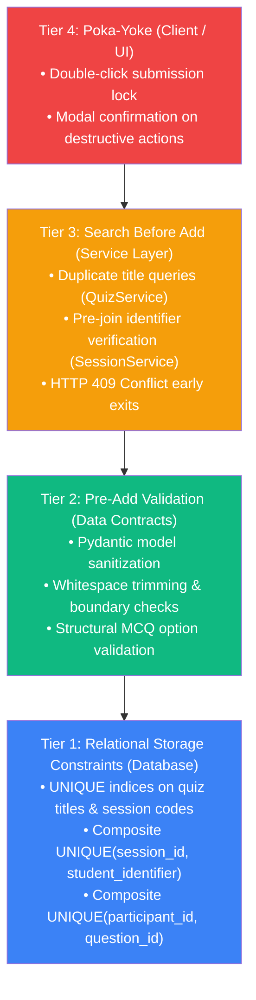

# Online Quiz Assessment System — Q06: Reduce Duplicate Entries

**Course:** BBAT104 — Fundamentals of Total Quality Management (TQM)  
**Student:** Saksham Singh Saloni (Roll No. `AU-24-5271`)  
**Academic Session:** 2026–27  
**Quality Goal:** **Q06 — Reduce Duplicate Entries**  
**Architecture:** Unified Web Platform (FastAPI + Jinja2 + SQLAlchemy 2.0 ORM + Alembic)  

---

## 1. Problem Statement & Quality Objectives

Online educational assessment platforms are highly vulnerable to relational and operational duplicate entries: duplicate test submissions, repeated student enrollments in a single test room, conflicting quiz titles, and identical question prompts.

This project engineers a production-grade **Online Quiz System** governed by Total Quality Management (TQM) principles. Specifically addressing **Quality Goal Q06 (Reduce Duplicate Entries)**, the platform implements a four-tier defense architecture ensuring zero duplicate entries across the assessment lifecycle.

### Assigned TQM Configuration

| Parameter | Specification |
|-----------|---------------|
| **Baseline Project** | Online Quiz System (Baseline No. 9) |
| **Quality Goal** | **Q06: Reduce Duplicate Entries** |
| **Q06 Core Features** | 1. Unique ID Constraints &bull; 2. Pre-add Validation &bull; 3. Search Before Add &bull; 4. Poka-Yoke Confirmation Dialogs |
| **Target Defect Rate** | **Zero duplicate entries** ($D = 0$) across concurrent operations |

---

## 2. 4-Tier Q06 Anti-Duplicate Defense Architecture



1. **Tier 1 (Storage):** Relational engine uniqueness (`ix_quizzes_title`, `ix_users_email`, `ix_sessions_session_code`, `uq_quiz_question_text`, `uq_session_participant`, `uq_participant_question`).
2. **Tier 2 (Pre-Add):** Input sanitization, whitespace normalization, and data validation via Pydantic schemas.
3. **Tier 3 (Service Layer):** Search-Before-Add verification queries raising HTTP 409 Conflict prior to any insert operation.
4. **Tier 4 (Presentation):** Client-side Poka-Yoke confirmation modals and double-submission blockers.

---

## 3. Technology Stack

| Layer | Technology | Purpose |
|-------|------------|---------|
| **Web Framework** | **FastAPI** + **Uvicorn** | High-performance asynchronous web & REST backend |
| **Frontend & SSR** | **Jinja2 Templates** + Vanilla JS/CSS | Zero-install unified web interface for instructors and students |
| **Persistence / ORM** | **SQLAlchemy 2.0** | Modern typed declarative ORM with connection pooling |
| **Database Migrations** | **Alembic** | Automated, version-controlled schema evolution |
| **Database Engines** | **PostgreSQL** (Prod) / **SQLite** (Dev/Test) | Engine portability with strict relational cascades |
| **Security & Auth** | **bcrypt** + **itsdangerous** | Salted password hashing & signed HTTP-only session cookies |
| **Testing** | **pytest** + **pytest-asyncio** + **httpx** | Comprehensive automated testing suite (Unit, Integration, API) |
| **SQC & Analytics** | **Pandas** + **Matplotlib** + **Seaborn** | Statistical process control and defect analytics (Reviews 3–4) |

---

## 4. User Journeys & Hybrid Authentication

### 👨‍🏫 Instructor Flow (Authenticated)
1. Navigate to `/auth/login` (or `/auth/register` to create an instructor account).
2. Log in with email and password to receive a tamper-proof session cookie.
3. Access `/dashboard` to manage quizzes, create questions, launch assessment sessions, and monitor live student performance.
4. Inspect real-time leaderboard rankings and item-wise accuracy analytics at `/sessions/{id}/results`.

### 🎓 Student Flow (Zero-Friction Ephemeral)
1. Navigate to `/join` on any web browser (no account creation required).
2. Enter Name, Roll Number / Student ID, and the 6-character Session Code.
3. Protected by Q06: The system validates that the session is active and that the roll number has not previously joined.
4. Take the quiz at `/session/{code}/take`, confirm answers with Poka-Yoke modal, and view instant scorecards and detailed feedback at `/session/{code}/results`.

---

## 5. Quickstart & Setup Guide

### Prerequisites
- Python 3.10+ (tested on Python 3.13)
- `pip` package manager

### Installation

```bash
# 1. Clone repository
git clone https://github.com/<your-username>/BBAT104_TQM_[AU-24-5271].git
cd BBAT104_TQM_[AU-24-5271]

# 2. Create and activate virtual environment
python -m venv venv
# On Windows:
venv\Scripts\activate
# On macOS/Linux:
source venv/bin/activate

# 3. Install dependencies
pip install -r requirements.txt

# 4. Copy environment configuration
cp .env.example .env

# 5. Apply database migrations
alembic upgrade head
```

### Running the Web Platform

```bash
uvicorn backend.main:app --reload --host 127.0.0.1 --port 8000
```

- **Web Application:** Open [http://127.0.0.1:8000](http://127.0.0.1:8000) in your browser.
- **Interactive Swagger API Docs:** [http://127.0.0.1:8000/docs](http://127.0.0.1:8000/docs)
- **ReDoc API Reference:** [http://127.0.0.1:8000/redoc](http://127.0.0.1:8000/redoc)

### Running Automated Tests

```bash
pytest tests/ -v
```

---

## 6. Repository Structure

```
├── .env.example                     # Environment template (DATABASE_URL, SECRET_KEY)
├── alembic.ini                      # Alembic migration configuration
├── alembic/                         # Database schema migration scripts
│   └── versions/
│       └── 5280994aae39_initial_schema_with_users.py
├── backend/
│   ├── config.py                    # Centralized twelve-factor app configuration
│   ├── database.py                  # SQLAlchemy 2.0 engine & session factory
│   ├── db_models.py                 # Declarative ORM entities (User, Quiz, Question, Session, Participant, Submission)
│   ├── main.py                      # FastAPI app entry point & route mounting
│   ├── models.py                    # Pydantic data schemas & validators (Q06 Tier 2)
│   ├── api/                         # REST API endpoints
│   │   ├── auth.py                  # Instructor register, login, logout, me
│   │   ├── quizzes.py               # Quiz CRUD endpoints
│   │   ├── questions.py             # Question CRUD endpoints
│   │   └── sessions.py              # Live session administration & student join/submit
│   ├── middleware/
│   │   └── auth.py                  # Signed cookie session middleware & dependencies
│   ├── repositories/                # Persistence & ORM queries
│   │   ├── quiz_repo.py
│   │   ├── question_repo.py
│   │   ├── user_repo.py
│   │   └── session_repo.py
│   └── services/                    # Business logic & Q06 defenses
│       ├── auth_service.py
│       ├── quiz_service.py
│       ├── question_service.py
│       ├── session_service.py
│       └── grading_service.py
├── frontend/
│   ├── routes/                      # Server-rendered web route handlers
│   │   ├── auth_routes.py           # Web login, register, logout pages
│   │   ├── teacher_routes.py        # Web dashboard, quiz library, question editor, session analytics
│   │   └── student_routes.py        # Web join, test taking, scorecard results
│   ├── static/
│   │   ├── css/style.css            # Production stylesheet
│   │   └── js/app.js                # Q06 Poka-Yoke modal, validation & double-submit guard
│   └── templates/                   # Jinja2 HTML templates
│       ├── base.html                # Base layout & navbar
│       ├── index.html               # Dual-portal landing page
│       ├── dashboard.html           # Instructor dashboard
│       ├── auth/                    # Login & registration templates
│       ├── quizzes/                 # Quiz & question management templates
│       ├── sessions/                # Results & analytics templates
│       ├── student/                 # Student assessment templates
│       └── partials/                # Reusable flash alerts & Poka-Yoke modal
├── docs/
│   ├── SRS.md                       # Software Requirements Specification (v2.0)
│   ├── stakeholders.md              # Formal Stakeholder Register (Stage 1)
│   ├── voice-of-stakeholder.md      # VoS Analysis & CTQ Flowdown (Stage 2)
│   ├── architecture.md              # System Architecture Specification (v2.0)
│   ├── database-design.md           # Entity-Relationship & Schema Spec (v2.0)
│   ├── api-design.md                # REST API Specification (v2.0)
│   ├── manual-test-plan.md          # 12 Structured Manual Test Cases (Stage 6)
│   ├── testing.md                   # Final Verification & QA Report (Stage 7)
│   ├── defect-log.md                # Empirical Defect Register (IEEE 829 / ISO 9001)
│   ├── scope.md                     # Review Phase Scope Boundaries
│   └── decisions/                   # Architecture Decision Records (ADRs)
│       ├── ADR-001-technology-stack.md
│       ├── ADR-002-database-upgrade.md
│       ├── ADR-003-web-pivot.md
│       └── ADR-004-hybrid-auth.md
├── tqm/                             # Stage 8 TQM Quality Artefacts
│   ├── README.md                    # Executive index & chart regeneration guide
│   ├── fmea.md                      # AIAG/VDA FMEA Matrix (98.97% RPN reduction)
│   ├── sipoc.md                     # ISO 9001 SIPOC Process Flowcharts
│   ├── pareto.md                    # Juran Pareto Analysis (Vital Few 62.5%)
│   ├── pareto_chart.png             # 300 DPI Publication-Grade Pareto Chart
│   ├── fishbone.md                  # 6M Ishikawa Cause-and-Effect Analysis
│   ├── ishikawa_fishbone.png        # 300 DPI Publication-Grade Fishbone Diagram
│   ├── pdca.md                      # Deming PDCA Continuous Improvement Cycle
│   ├── generate_pareto.py           # SQC Pareto Chart Generator Script
│   └── generate_fishbone.py         # SQC Fishbone Generator Script
├── requirements.txt                 # Python project dependencies
├── test-results/
│   └── automated-results.xml        # JUnit XML Test Execution Artifact
└── tests/                           # Automated test suites (66 tests, 100% passing)
    ├── conftest.py                  # Shared isolated SQLite test client fixtures
    ├── test_api.py                  # REST API contract & CRUD endpoints (14 tests)
    ├── test_auth.py                 # Registration, login, profile & password auth (14 tests)
    ├── test_database.py             # Schema & cascading integrity (5 tests)
    ├── test_grading.py              # Evaluation & grading logic (4 tests)
    ├── test_pages.py                # Web SSR page workflows, student flow & profile (12 tests)
    ├── test_services.py             # Pre-add validation & search-before-add (7 tests)
    └── test_sessions.py             # Live session lifecycle & auto-grading (10 tests)
```

---

## 7. Quality Assurance & Testing Summary

All **66 automated unit and integration tests** execute successfully with a **100% pass rate** in ~25 seconds:
- **`tests/test_auth.py` (14 tests):** Validates teacher registration, duplicate email rejection (409), password hashing, login, authentication cookies, logout, profile name update, Tier 2 blank name rejection, password changes, unauthenticated profile update rejection (401), and short password rejection (422).
- **`tests/test_sessions.py` (10 tests):** Validates session code generation, participant enrollment, duplicate join rejection, student answer isolation, submission auto-grading, duplicate submission blocking, and analytics.
- **`tests/test_pages.py` (12 tests):** Validates server-rendered HTML pages, unauthenticated redirect protection, teacher dashboard, web form quiz creation with duplicate detection, question authoring across MCQ/True-False/Short-Answer, student assessment flow, profile page rendering, display name updating, blank name rejection, password updating, and password mismatch rejection.
- **`tests/test_api.py` (14 tests):** Validates REST API endpoints for quizzes and questions, duplicate rejection responses (`409 Conflict`), and update constraints.
- **`tests/test_services.py` (7 tests):** Validates whitespace stripping, pre-add validation, MCQ structural consistency, and Search-Before-Add duplicate detection.
- **`tests/test_database.py` (5 tests):** Validates table creation, foreign key cascading deletion, unique session code constraints, composite unique participant constraints (`uq_session_participant`), and user profile/password persistence.
- **`tests/test_grading.py` (4 tests):** Validates case-insensitive short answer evaluation, whitespace trimming, and true/false verification.

In addition, **13 structured manual test cases (`TC-MAN-01` to `TC-MAN-13`)** in `docs/manual-test-plan.md` have been verified passing in live browser sessions, yielding **79 total verified checks**.

---

## 8. Academic Integrity & TQM Compliance
Developed by **Saksham Singh Saloni (Roll No. AU-24-5271)** for **BBAT104 Fundamentals of Total Quality Management**. All architectural decisions, Voice of Stakeholder traceability, and empirical defect tracking are mapped directly to course rubrics.
