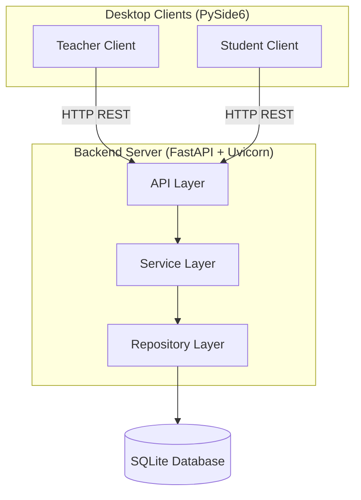

# Online Quiz System — Q06: Reduce Duplicate Entries

**Course:** BBAT104 — Fundamentals of TQM
**Student:** Saksham Singh Saloni (AU-24-5271)
**Academic Session:** 2026–27

---

## Problem Statement

Online quiz systems are susceptible to data integrity issues including duplicate records, invalid entries, and inconsistent data. This project implements an Online Quiz System with a focus on **Quality Goal Q06 — Reduce Duplicate Entries**, applying TQM principles to ensure reliable, error-free data management throughout the quiz lifecycle.

## Project Objectives

1. Build a functioning Online Quiz System with full CRUD operations for quizzes and questions.
2. Implement 4 Q06 quality features to systematically reduce duplicate entries.
3. Apply TQM principles (FMEA, SIPOC, Pareto, Fishbone, PDCA) to the development process.
4. Maintain a professional, well-documented codebase with meaningful version control history.

## Assigned Configuration

| Parameter | Value |
|-----------|-------|
| Baseline System | Online Quiz System |
| Quality Goal | Q06 — Reduce Duplicate Entries |
| Q06 Features | Unique ID Constraints, Pre-add Validation, Search Before Add, Confirmation Dialogs |

---

## System Architecture



The system uses a **client-server architecture**:

- **Desktop clients** (PySide6) handle presentation only.
- **Backend server** (FastAPI) owns all business logic, validation, and data access.
- **SQLite database** is accessed exclusively by the backend, enforcing data integrity at the storage level.

This architecture supports future internet deployment without redesign.

## Technology Stack

| Layer | Technology |
|-------|-----------|
| Desktop UI | PySide6 |
| Backend API | FastAPI + Uvicorn |
| Database | SQLite3 |
| HTTP Client | httpx |
| Validation | Pydantic |
| Testing | pytest |
| SQC Charts | Matplotlib + Seaborn + Pandas |

---

## Repository Structure

```
├── README.md              # This file
├── .gitignore             # Git exclusions
├── requirements.txt       # Python dependencies
├── docs/
│   ├── SRS.md             # Software Requirements Specification
│   ├── scope.md           # Scope definition
│   ├── architecture.md    # Architecture document with diagrams
│   ├── database-design.md # Database schema and constraints
│   ├── api-design.md      # API endpoint specifications
│   └── decisions/         # Architectural decision records
├── backend/
│   ├── main.py            # FastAPI application entry point
│   ├── database.py        # Database initialization and connection
│   ├── models.py          # Pydantic request/response models
│   ├── api/               # HTTP route handlers
│   ├── services/          # Business logic
│   └── repositories/      # Data access layer
├── apps/
│   ├── teacher/           # Teacher desktop client
│   └── student/           # Student desktop client (planned)
├── tests/                 # Automated tests
├── screenshots/           # Evidence for reviews
└── tqm/                   # TQM analysis artefacts
```

---

## Q06: Reduce Duplicate Entries — Feature Summary

| # | Feature | Where Implemented | Description |
|---|---------|------------------|-------------|
| 1 | **Unique ID Constraints** | Database | PRIMARY KEY, UNIQUE constraints, composite unique keys prevent duplicate records at the storage level |
| 2 | **Pre-add Validation** | Service Layer | All inputs validated for required fields, acceptable lengths, and valid types before database insertion |
| 3 | **Search Before Add** | Service Layer | Existing records searched by relevant fields before creation; duplicates detected and reported |
| 4 | **Confirmation Dialogs** | Teacher Client | PySide6 confirmation prompts before delete operations and other destructive actions |

---

## Setup Instructions

### Prerequisites

- Python 3.10 or later
- Git

### Installation

```bash
# Clone the repository
git clone https://github.com/<username>/BBAT104_TQM_[AU-24-5271].git
cd BBAT104_TQM_[AU-24-5271]

# Create a virtual environment
python -m venv venv

# Activate the virtual environment
# Windows:
venv\Scripts\activate
# macOS/Linux:
source venv/bin/activate

# Install dependencies
pip install -r requirements.txt
```

### Running the Backend

```bash
uvicorn backend.main:app --reload
```

The API will be available at `http://localhost:8000`. Interactive docs at `http://localhost:8000/docs`.

### Running the Teacher Client

```bash
python -m apps.teacher.main
```

### Running Tests

Execute the automated test suite using `pytest`:

```bash
pytest tests/ -v
```

All 17 automated tests pass in `< 1.0s` verifying:
- ✅ Base CRUD operations for Quizzes and Questions
- ✅ Q06 Feature 1: Unique ID Constraints (`tests/test_database.py`)
- ✅ Q06 Feature 2: Pre-add Validation (`tests/test_services.py`, `tests/test_api.py`)
- ✅ Q06 Feature 3: Search Before Add duplicate detection (`tests/test_services.py`)
- ✅ Q06 Feature 4: Confirmation Dialogs on deletion (`apps/teacher/views/`)

📄 **Detailed Evidence:** See the full execution output and breakdown in [Automated Testing Report (docs/testing.md)](docs/testing.md).

---

## Implementation Status

| Component | Status | Review Milestone |
|-----------|--------|------------------|
| Repository setup | ✅ Complete | Review 1 |
| Documentation (SRS, scope, architecture) | ✅ Complete | Review 1 |
| Database schema & constraints | ✅ Complete | Review 2 |
| Quiz CRUD API | ✅ Complete | Review 2 |
| Question CRUD API | ✅ Complete | Review 2 |
| Q06: Unique ID Constraints | ✅ Complete | Review 2 |
| Q06: Pre-add Validation | ✅ Complete | Review 2 |
| Q06: Search Before Add | ✅ Complete | Review 2 |
| Q06: Confirmation Dialogs | ✅ Complete | Review 2 |
| Teacher desktop client (PySide6) | ✅ Complete | Review 2 |
| Automated tests (17 test cases) | ✅ Complete | Review 2 |
| Student desktop client | 🔲 Planned | Stretch / Post-Review 2 |
| TQM artefacts (FMEA, SIPOC, etc.) | 🔲 Planned | Reviews 3–4 |

---

## Known Limitations

- The system currently operates on localhost. Internet deployment is architecturally supported but not yet configured.
- Only the 4 officially listed Q06 features are implemented. The guidelines specify 5 features per quality goal, but Q06 lists only 4. This discrepancy is documented and pending professor clarification.
- WebSocket-based real-time updates are designed for but not yet implemented.

## Future Roadmap

1. **Review 2:** Complete CRUD modules, Q06 features, teacher client, automated tests.
2. **Review 3:** FMEA matrix, SIPOC diagram, CTQ tree, defect logging.
3. **Review 4:** Pareto charts, Fishbone diagrams, checksheets, PDCA cycle.
4. **Final:** Live demonstration, complete documentation, ≥30 commits.
5. **Post-course:** Internet deployment, student client enhancements, real-time progress monitoring.

---

## License

Academic project — BBAT104 Course, Amity University.
