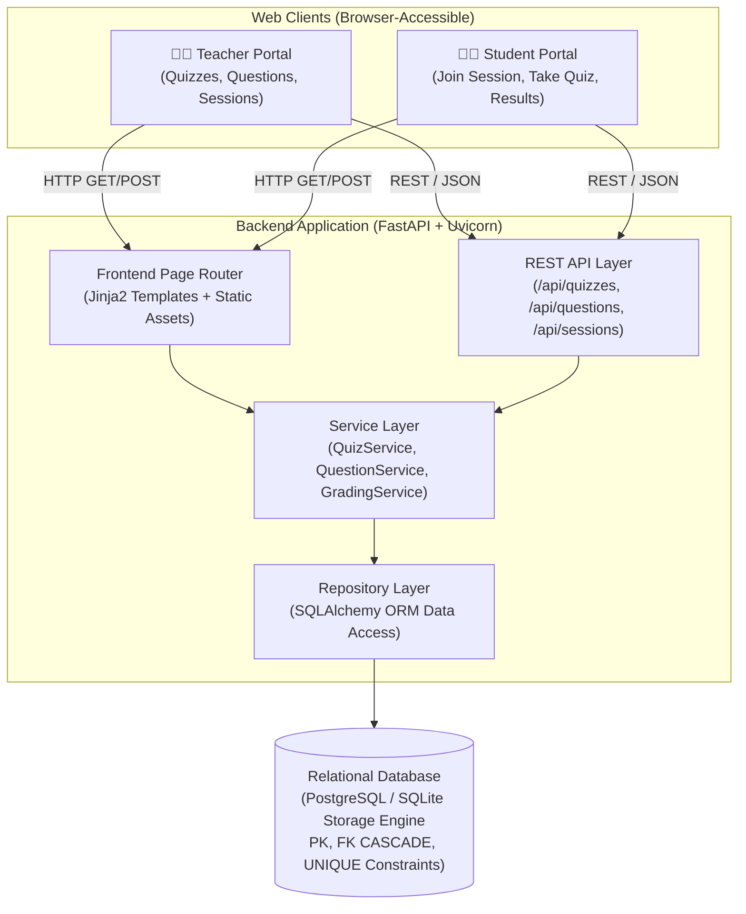

# Software Requirements Specification (SRS)

**Project:** Online Quiz System — Q06: Reduce Duplicate Entries  
**Course:** BBAT104 — Fundamentals of Total Quality Management (TQM)  
**Student:** Saksham Singh Saloni (Roll No: AU-24-5271)  
**Academic Session:** 2026–27  
**Version:** 2.0 (Post-VoS Traceability Alignment)  
**Date:** 2026-11-16  

---

## 1. Introduction

### 1.1 Purpose
This document specifies the software requirements for the **Online Quiz System**, an academic web application that enables instructors to author and conduct assessments and students to participate and receive automated, objective evaluation. 

In strict compliance with the TQM engineering pipeline, this specification is **empirically derived from formal stakeholder analysis** and **Voice of the Stakeholder (VoS)** translation. The system places primary emphasis on **Quality Goal Q06 (Reduce Duplicate Entries)** to safeguard database integrity, eliminate redundant records, and prevent user errors through defensive engineering (Poka-Yoke).

### 1.2 Scope
The Online Quiz System encompasses:
- A **backend server** (FastAPI) owning all application routing, relational persistence, business logic, validation rules, auto-grading, and duplicate prevention.
- A **relational persistence layer** enforcing primary keys, foreign key cascading deletions, and uniqueness constraints.
- A **web-based interface** (server-rendered templates via Jinja2 with modern CSS/JS) replacing the initial desktop prototype to support concurrent, multi-device classroom access.
- An **automated test suite and quality verification harness** validating all functional requirements and Q06 mechanisms against empirical pass/fail criteria.

### 1.3 Stakeholder Foundation & Voice Traceability
In alignment with Stage 1 and Stage 2 of the TQM pipeline, requirements in this SRS originate from 6 formally registered stakeholders and 17 analyzed voices:
- **Reference Document 1:** [Stakeholder Register (docs/stakeholders.md)](stakeholders.md) (`SH-01` through `SH-06`)
- **Reference Document 2:** [Voice of the Stakeholder & CTQ Translation (docs/voice-of-stakeholder.md)](voice-of-stakeholder.md) (`VoS-01` through `VoS-17`)

| Stakeholder ID | Role | Key TQM Interest | Originating Voices |
| :--- | :--- | :--- | :--- |
| **SH-01** | Teacher / Conductor | Duplicate quiz/question prevention; deletion safety nets | `VoS-01`, `VoS-02`, `VoS-03`, `VoS-04` |
| **SH-02** | Student / Participant | Fair normalized grading; idempotent joins & submissions | `VoS-05`, `VoS-06`, `VoS-07` |
| **SH-03** | Professor / Evaluator | Pipeline adherence; verifiable test evidence; defect logging | `VoS-08`, `VoS-09`, `VoS-10` |
| **SH-04** | University / Institution | Relational integrity; audit timestamps; zero orphan data | `VoS-11`, `VoS-12` |
| **SH-05** | Software Developer | Three-tier decoupling; pre-add boundary validation | `VoS-13`, `VoS-14` |
| **SH-06** | System Administrator | Concurrency support; reproducible migrations; health probes | `VoS-15`, `VoS-16`, `VoS-17` |

### 1.4 Definitions and Abbreviations
| Term | Definition |
| :--- | :--- |
| **CRUD** | Create, Read, Update, Delete operations |
| **Q06** | Quality Goal 06 — Reduce Duplicate Entries |
| **VoS / VoC**| Voice of the Stakeholder / Voice of the Customer |
| **CTQ** | Critical to Quality metric |
| **Poka-Yoke**| Japanese term for "mistake-proofing"; mechanisms designed to prevent human error |
| **SRS** | Software Requirements Specification |
| **API** | Application Programming Interface (RESTful HTTP) |
| **RDBMS** | Relational Database Management System |
| **FMEA** | Failure Mode and Effects Analysis (Reviews 3–4) |
| **PDCA** | Plan-Do-Check-Act quality cycle |

---

## 2. Overall System Description

### 2.1 System Architecture Overview

### 2.2 Key Design Principles
1. **Separation of Concerns:** Presentation logic (HTML/CSS/JS) is isolated from business rules (Service layer) and data access (Repository layer).
2. **Server-Side Authority:** Client inputs are treated as untrusted. All duplicate detection, boundary validation, and grading computations are enforced server-side.
3. **Defense-in-Depth (Q06):** Duplicate entry reduction is enforced at four distinct architectural tiers:
   - *Tier 1 (Client):* Interactive confirmation dialogs before destructive operations (Poka-Yoke).
   - *Tier 2 (Boundary):* Pydantic schemas validating non-emptiness, bounds, and MCQ consistency.
   - *Tier 3 (Service):* Search-Before-Add algorithms auditing existing records and returning HTTP 409 on collision.
   - *Tier 4 (Database):* Storage-level `PRIMARY KEY`, `UNIQUE`, and composite uniqueness constraints.
4. **Referential Integrity:** Parent entity deletions strictly cascade (`ON DELETE CASCADE`) to eliminate orphaned child rows.

---

## 3. Functional Requirements

### 3.1 Quiz Management

| ID | Requirement Specification | Source Voice | Priority | Target Release |
| :--- | :--- | :--- | :--- | :--- |
| **FR-01** | **Create Quiz:** The instructor can author a new quiz by providing a title and optional description. Inputs are validated for whitespace-only strings. Duplicate titles are audited and blocked prior to database insertion. | `VoS-01` (SH-01) | Must | Review 2 |
| **FR-02** | **List Quizzes:** The system displays all available quizzes with assigned ID, title, description, question count, and creation timestamp. | `VoS-04` (SH-01) | Must | Review 2 |
| **FR-03** | **Update Quiz:** The instructor can modify the title and description of an existing quiz. Title updates trigger a duplicate search against other existing quizzes. | `VoS-01` (SH-01) | Must | Review 2 |
| **FR-04** | **Delete Quiz:** The instructor can delete a quiz. The system triggers an interactive confirmation prompt prior to executing the deletion. Deletion cascades to all associated questions, sessions, and submissions. | `VoS-03` (SH-01), `VoS-11` (SH-04) | Must | Review 2 |

### 3.2 Question Management

| ID | Requirement Specification | Source Voice | Priority | Target Release |
| :--- | :--- | :--- | :--- | :--- |
| **FR-05** | **Add Question to Quiz:** The instructor can add questions to a quiz, specifying question text, question type (`mcq`, `true_false`, `short_answer`), options list, correct answer, points ($\ge 1$), and display order. Scoped duplicate check ensures identical question text is not added to the same quiz twice. | `VoS-02` (SH-01), `VoS-14` (SH-05) | Must | Review 2 |
| **FR-06** | **List Questions by Quiz:** The system retrieves and displays all questions belonging to a selected quiz in defined order. | `VoS-02` (SH-01) | Must | Review 2 |
| **FR-07** | **Update Question:** The instructor can edit question text, options, answer key, and points. The service layer validates that the correct answer remains present in the options list for MCQs and prevents duplicate text within the quiz. | `VoS-02` (SH-01), `VoS-14` (SH-05) | Must | Review 2 |
| **FR-08** | **Delete Question:** The instructor can remove an individual question from a quiz, subject to an interactive confirmation check. Deletion cascades to associated submissions. | `VoS-03` (SH-01), `VoS-11` (SH-04) | Must | Review 2 |

### 3.3 Quiz Session & Evaluation Flow (Extended Scope)

| ID | Requirement Specification | Source Voice | Priority | Target Release |
| :--- | :--- | :--- | :--- | :--- |
| **FR-09** | **Start Quiz Session:** The instructor can initiate a live quiz session, generating a unique random alphanumeric `session_code`. | `VoS-06` (SH-02), `VoS-12` (SH-04) | Should | Reviews 2–3 |
| **FR-10** | **Join Session:** Students join active sessions via session code, student name, and student identifier. The system blocks duplicate joins for the same student identifier within the session. | `VoS-06` (SH-02) | Should | Reviews 2–3 |
| **FR-11** | **Submit Answer:** A participant submits answers question-by-question or in batch. The system rejects duplicate submissions for the same question by the same participant. | `VoS-06` (SH-02) | Should | Reviews 2–3 |
| **FR-12** | **Automated Objective Grading:** The system evaluates submissions against answer keys. Short-answer evaluations are normalized ($\text{trim}$ + $\text{lowercase}$) to eliminate false negatives. | `VoS-05` (SH-02) | Should | Reviews 2–3 |
| **FR-13** | **View Performance Results:** Students immediately receive their final score, total points, and answer evaluations upon concluding the quiz. | `VoS-07` (SH-02) | Should | Reviews 2–3 |
| **FR-14** | **Instructor Session Summary:** Instructors can view participant rosters, individual scores, and class aggregate statistics. | `VoS-04` (SH-01) | Could | Reviews 3–4 |

### 3.4 Q06 Quality Goal Requirements (Reduce Duplicate Entries)

| ID | Quality Feature | Requirement Specification | Source Voice | Priority |
| :--- | :--- | :--- | :--- | :--- |
| **FR-Q1** | **Unique ID Constraints** | The database schema enforces uniqueness at the storage level: `quizzes.title` UNIQUE, `sessions.session_code` UNIQUE, `UNIQUE(session_id, student_identifier)`, and `UNIQUE(participant_id, question_id)`. Storage-level violations raise integrity errors. | `VoS-01`, `VoS-06`, `VoS-11` | Must |
| **FR-Q2** | **Pre-add Validation** | Pydantic schemas intercept all payload mutations at the HTTP boundary, enforcing non-empty trimmed strings, bounds checks ($1 \le \text{points} \le 100$, $2 \le \text{options} \le 6$), and verifying that MCQ correct answers exist in options. | `VoS-14` (SH-05) | Must |
| **FR-Q3** | **Search Before Add** | Before executing inserts or updates, repository queries audit existing titles and question prompts. If a match is detected, the operation aborts with a descriptive message and HTTP 409 Conflict. | `VoS-01`, `VoS-02` (SH-01) | Must |
| **FR-Q4** | **Confirmation Dialogs** | Destructive actions (deleting quizzes, deleting questions) cannot be triggered in a single click. Web clients present an explicit confirmation modal/dialog (Poka-Yoke) requiring positive user confirmation. | `VoS-03` (SH-01) | Must |

---

## 4. Non-Functional Requirements (NFRs)

| ID | Category | Specification & CTQ Target | Source Voice | Priority |
| :--- | :--- | :--- | :--- | :--- |
| **NFR-01** | **Data Integrity** | Relational foreign keys enforce `ON DELETE CASCADE`. Zero orphaned child records exist after parent entity deletion. | `VoS-11` (SH-04) | Must |
| **NFR-02** | **Auditability** | All state changes record standardized ISO 8601 UTC timestamps (`created_at`, `updated_at`, `started_at`, `submitted_at`). | `VoS-12` (SH-04) | Must |
| **NFR-03** | **Evaluation Fairness** | Automated grading normalizes whitespace and letter casing: $\text{eval}(\text{" Python "}) == \text{eval}(\text{"python"})$. False negative rate $= 0\%$. | `VoS-05` (SH-02) | Must |
| **NFR-04** | **Architectural Decoupling** | Strict three-tier separation. Service modules contain zero SQL; repository modules contain zero HTTP/UI logic. | `VoS-13` (SH-05) | Must |
| **NFR-05** | **Concurrency & Scalability** | System architecture supports concurrent student submissions during live exam sessions without table/file locking or deadlocks. | `VoS-15` (SH-06) | Must |
| **NFR-06** | **Schema Versioning** | Database DDL is versioned and automated via migration scripts (Alembic). Zero manual un-tracked schema alterations. | `VoS-16` (SH-06) | Must |
| **NFR-07** | **Observability** | `GET /` serves as a health probe returning HTTP 200 with service metadata and documentation links in $< 50\text{ms}$. | `VoS-17` (SH-06) | Must |
| **NFR-08** | **Testability & Velocity** | Comprehensive automated test suite executes in $< 2.0\text{s}$ with $100\%$ pass rate on all Q06 verification paths. | `VoS-10` (SH-03) | Must |

---

## 5. External Interface Requirements

### 5.1 User Interfaces (Web Application)
- **Teacher Workspace:** Responsive browser views for managing quizzes, authoring questions, and monitoring results. Deletion actions incorporate browser-level confirmation modals (`VoS-03`).
- **Student Assessment Portal:** Minimalist, high-focus interface for joining sessions via code, answering questions sequentially, and viewing graded scorecards.

### 5.2 Software Interfaces
- **FastAPI Framework:** Serves RESTful endpoints (`/api/*`) and Jinja2-templated HTML views.
- **Relational Persistence Engine:** SQLAlchemy 2.0 ORM interfacing with PostgreSQL (production) or SQLite (test suite).
- **Alembic Engine:** Executes programmatic schema upgrades (`alembic upgrade head`).

---

## 6. Data Model & Integrity Constraints

| Table Name | Primary Key | Foreign Keys & Cascade Rules | Uniqueness Constraints (Q06 Tier 4) |
| :--- | :--- | :--- | :--- |
| `quizzes` | `id` (INTEGER PK AUTO) | None | `title` (TEXT UNIQUE NOT NULL) |
| `questions` | `id` (INTEGER PK AUTO) | `quiz_id` $\rightarrow$ `quizzes(id)` ON DELETE CASCADE | `CONSTRAINT uq_quiz_question_text UNIQUE (quiz_id, question_text)` |
| `sessions` | `id` (INTEGER PK AUTO) | `quiz_id` $\rightarrow$ `quizzes(id)` ON DELETE CASCADE | `session_code` (TEXT UNIQUE NOT NULL) |
| `participants`| `id` (INTEGER PK AUTO) | `session_id` $\rightarrow$ `sessions(id)` ON DELETE CASCADE | `CONSTRAINT uq_session_participant UNIQUE (session_id, student_identifier)` |
| `submissions` | `id` (INTEGER PK AUTO) | `participant_id` $\rightarrow$ `participants(id)` ON DELETE CASCADE `question_id` $\rightarrow$ `questions(id)` ON DELETE CASCADE | `CONSTRAINT uq_participant_question UNIQUE (participant_id, question_id)` |

---

## 7. End-to-End Requirements Traceability Matrix

This matrix establishes the complete TQM audit trail connecting each **Stakeholder Voice** through to the **Code Module**, **Verification Test**, and **Implementation Status**:

| Voice ID | Stakeholder | Requirement ID | System Component / Module | Test / Verification Method | Status |
| :--- | :--- | :--- | :--- | :--- | :---: |
| **VoS-01** | SH-01 (Teacher) | `FR-01`, `FR-Q3` | `backend/services/quiz_service.py` | `test_api_q06_search_before_add_rejects_duplicate_quiz` | ✅ Verified |
| **VoS-02** | SH-01 (Teacher) | `FR-05`, `FR-Q3` | `backend/services/question_service.py` | `test_api_q06_search_before_add_rejects_duplicate_question` | ✅ Verified |
| **VoS-03** | SH-01 (Teacher) | `FR-04`, `FR-08`, `FR-Q4` | `frontend/static/js/app.js` | Manual Test Scenario `MT-03` (Confirmation Prompts) | ✅ Verified |
| **VoS-04** | SH-01 (Teacher) | `FR-02` | `backend/api/quizzes.py` | `test_api_list_quizzes` | ✅ Verified |
| **VoS-05** | SH-02 (Student) | `FR-12`, `NFR-03` | `backend/services/grading_service.py` | `test_short_answer_case_insensitivity`, `test_short_answer_whitespace_trimming` | ✅ Verified |
| **VoS-06** | SH-02 (Student) | `FR-10`, `FR-11`, `FR-Q1` | `backend/database.py` (SQLAlchemy models) | `test_q06_unique_participant_per_session_constraint` | ✅ Verified |
| **VoS-07** | SH-02 (Student) | `FR-13` | `backend/services/grading_service.py` | `test_grading.py` (all tests) | ✅ Verified |
| **VoS-08** | SH-03 (Professor) | System Pipeline | `docs/` (`stakeholders.md` $\rightarrow$ `SRS.md`) | Stage-by-stage document audit | ✅ Verified |
| **VoS-09** | SH-03 (Professor) | Defect Logging | `docs/testing.md`, `docs/defect-log.md` | JUnit XML report + Defect Register | 🔲 Stage 7 |
| **VoS-10** | SH-03 (Professor) | Q06 Coverage | `tests/` (29 automated test cases) | `pytest tests/ -v` (100% pass rate in $<1.3\text{s}$) | ✅ Verified |
| **VoS-11** | SH-04 (University) | `NFR-01` | `backend/database.py` | `test_foreign_key_cascade_deletion` | ✅ Verified |
| **VoS-12** | SH-04 (University) | `NFR-02` | `backend/models.py`, `backend/repositories/` | `test_tables_created_successfully` (schema inspection) | ✅ Verified |
| **VoS-13** | SH-05 (Developer) | `NFR-04` | `backend/` (API $\rightarrow$ Service $\rightarrow$ Repo) | Codebase inspection (zero cross-tier leakage) | ✅ Verified |
| **VoS-14** | SH-05 (Developer) | `FR-Q2` | `backend/models.py` (Pydantic schemas) | `test_api_q06_pre_add_validation_rejects_empty_title` | ✅ Verified |
| **VoS-15** | SH-06 (SysAdmin) | `NFR-05` | `backend/database.py`, `backend/db_models.py` | SQLAlchemy connection pooling + PostgreSQL setup | 🔲 Stage 4 |
| **VoS-16** | SH-06 (SysAdmin) | `NFR-06` | `alembic/` | `alembic upgrade head` automated execution | 🔲 Stage 4 |
| **VoS-17** | SH-06 (SysAdmin) | `NFR-07` | `backend/main.py` | `GET /` endpoint health check verification | ✅ Verified |
