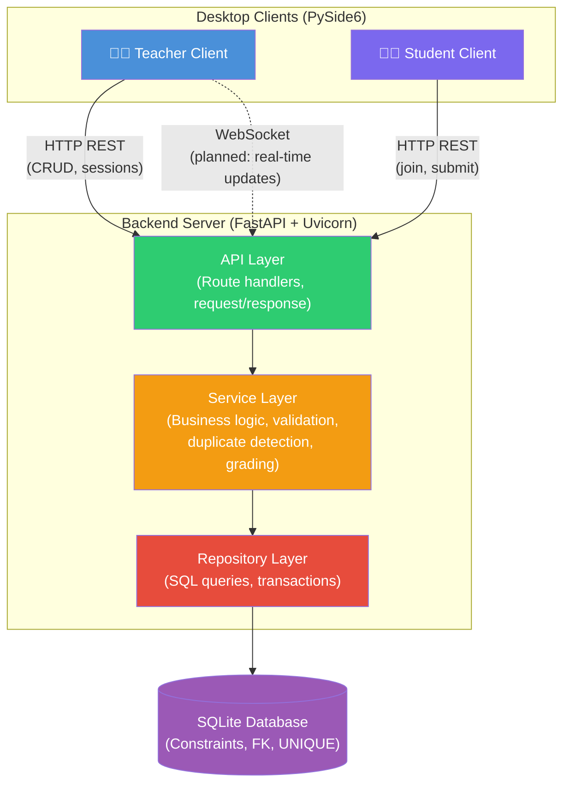
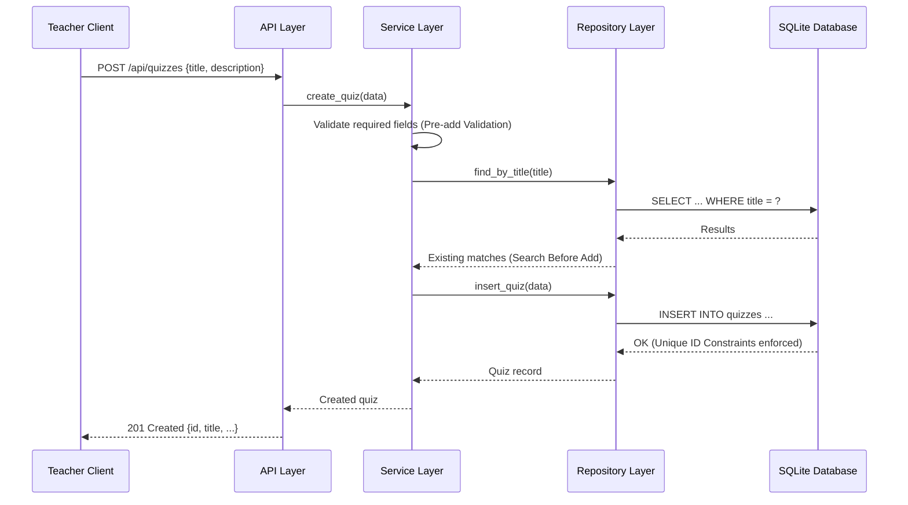
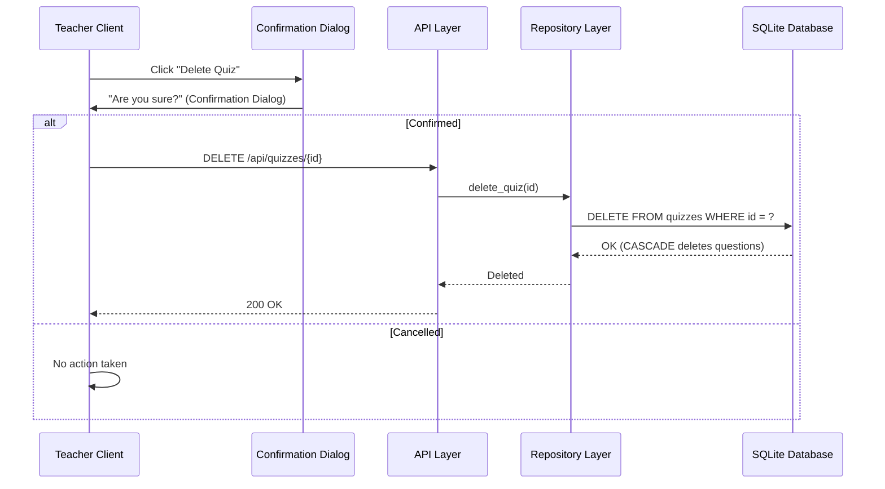
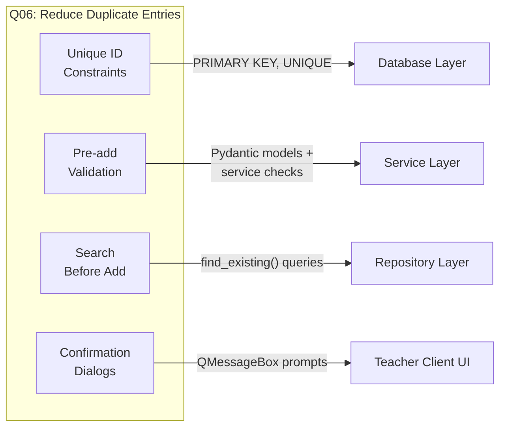

# System Architecture

**Project:** Online Quiz System — Q06: Reduce Duplicate Entries
**Version:** 1.0 | **Date:** 2026-10-11

---

## 1. Architecture Overview

The Online Quiz System uses a **client-server architecture** where desktop clients communicate with a central backend over HTTP REST APIs. The backend is the single authority for data access, validation, grading, and duplicate prevention.

### System Architecture Flowchart

### Data Flow — Quiz CRUD Example

### Data Flow — Delete with Confirmation

---

## 2. Component Details

### 2.1 Desktop Clients (PySide6)

**Responsibility:** Presentation layer only. Renders UI, captures user input, displays responses. Contains no business logic or database access.

| Component | Purpose |
|-----------|---------|
| `apps/teacher/main.py` | Teacher application entry point |
| `apps/teacher/api_client.py` | HTTP client wrapping backend API calls |
| `apps/teacher/views/main_window.py` | Main window with navigation |
| `apps/teacher/views/quiz_view.py` | Quiz CRUD interface |
| `apps/teacher/views/question_view.py` | Question CRUD interface |
| `apps/student/` | Student application (planned) |

**Key design rules:**
- All data operations go through the API client → backend.
- Confirmation dialogs are implemented here (Q06 Feature D).
- UI displays error messages returned by the backend.

### 2.2 Backend Server (FastAPI)

**Responsibility:** Application logic, validation, data access, grading. Single authority for all data operations.

#### API Layer (`backend/api/`)

- Defines HTTP route handlers.
- Parses request bodies using Pydantic models.
- Returns structured JSON responses with appropriate HTTP status codes.
- Delegates all logic to the service layer.

#### Service Layer (`backend/services/`)

- Implements business logic: validation, duplicate detection, grading.
- Enforces Q06 features: Pre-add Validation and Search Before Add.
- Does not construct SQL queries directly.

#### Repository Layer (`backend/repositories/`)

- Executes SQL queries against the database.
- Manages transactions.
- Returns plain data to the service layer.

### 2.3 Database (SQLite3)

**Responsibility:** Persistent storage with integrity enforcement.

- Enforces PRIMARY KEY, UNIQUE, NOT NULL, and FOREIGN KEY constraints.
- CASCADE delete behaviour for parent-child relationships.
- Accessed exclusively by the backend process.
- Schema managed by `backend/database.py`.

---

## 3. Technology Stack

| Layer | Technology | Version | Purpose |
|-------|-----------|---------|---------|
| Desktop UI | PySide6 | ≥ 6.7 | Cross-platform Qt-based desktop interface |
| Backend | FastAPI | ≥ 0.115 | Async REST API framework with auto-validation |
| ASGI Server | Uvicorn | ≥ 0.30 | Serves the FastAPI application |
| HTTP Client | httpx | ≥ 0.27 | Desktop client → backend communication |
| Database | SQLite3 | Built-in | Zero-config persistent storage |
| Validation | Pydantic | ≥ 2.9 | Request/response data models (bundled with FastAPI) |
| Testing | pytest | ≥ 8.3 | Automated test framework |
| Data Analysis | Pandas + Matplotlib + Seaborn | — | SQC charts (Reviews 3–4) |

---

## 4. Q06 Feature Integration Points

---

## 5. Deployment Architecture (Planned)

For internet-based deployment, the architecture transitions as follows:

| Aspect | Local Development | Internet Deployment |
|--------|------------------|-------------------|
| Backend host | `localhost:8000` | Cloud server with public IP |
| Database | SQLite file | PostgreSQL (if concurrency demands) |
| Protocol | HTTP | HTTPS with TLS |
| Client config | Hardcoded localhost | Configurable server URL |
| Real-time updates | Polling or deferred | WebSocket connection |

The client-server separation ensures this transition requires only configuration changes, not architectural changes.
