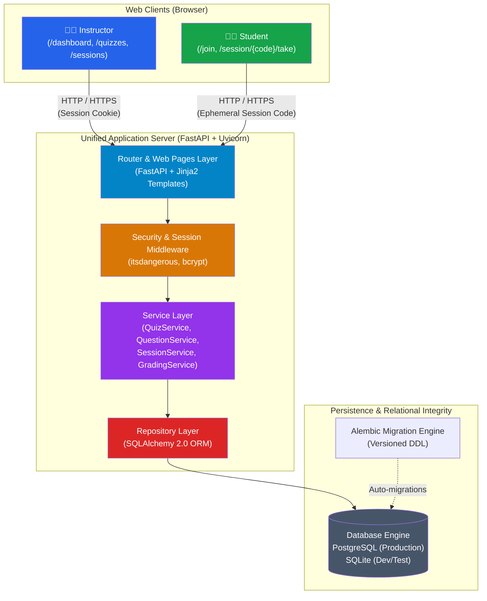
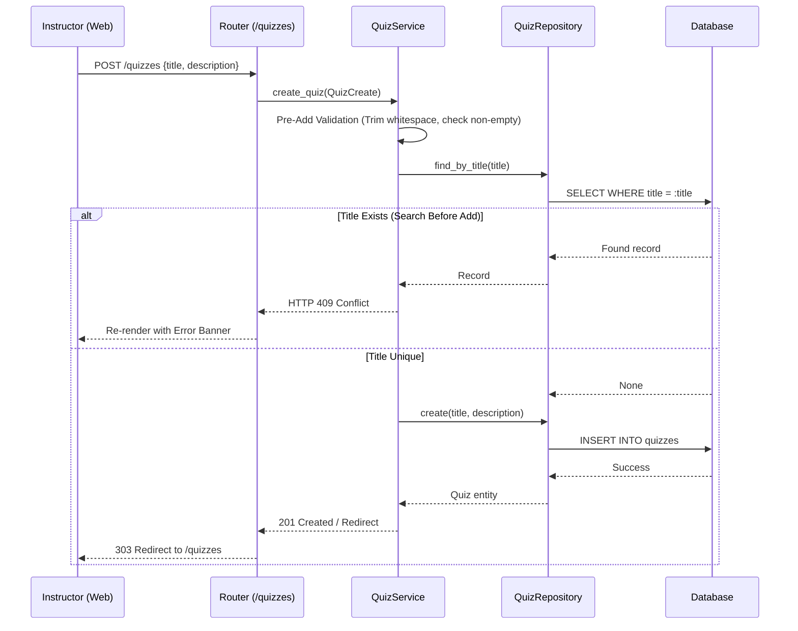
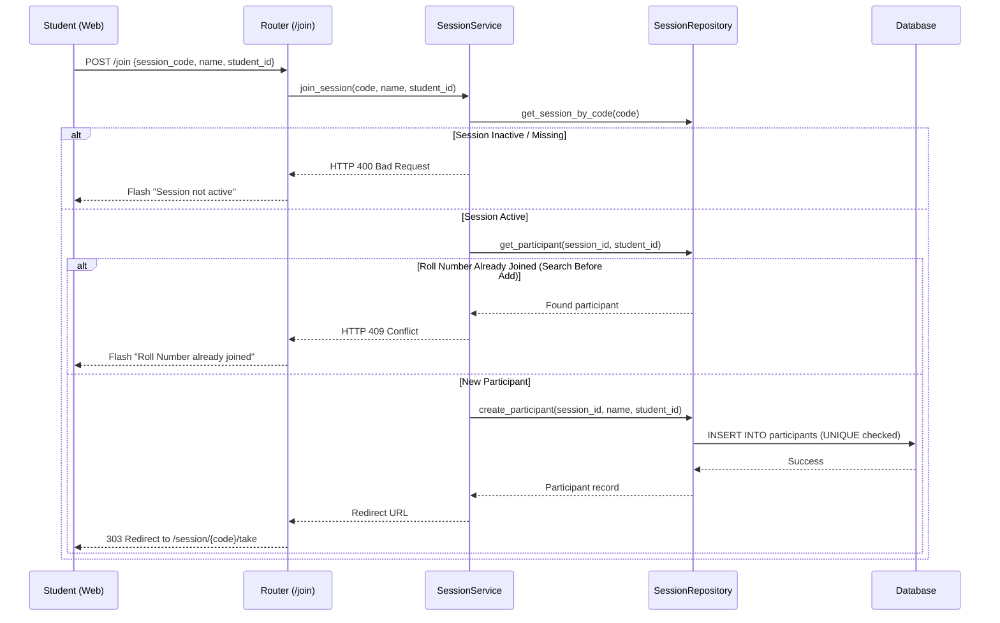

# System Architecture

**Project:** Online Quiz System — Q06: Reduce Duplicate Entries  
**Version:** 2.0 | **Date:** 2026-11-16  
**Stack:** FastAPI + Jinja2 Web Server | SQLAlchemy 2.0 ORM | PostgreSQL / SQLite  

---

## 1. Architecture Overview

The Online Quiz System is built as a **unified server-rendered web application** with an integrated REST API. It eliminates external desktop dependencies, enabling instructors and students to interact seamlessly via standard web browsers.

---

## 2. Layered Component Architecture

### 2.1 Web Presentation & Routing Layer (`frontend/`)
- **Jinja2 Server-Side Templates (`frontend/templates/`):**
  - Modular templates with base layout (`base.html`), navigation, flash notifications (`_flash.html`), and modal components.
  - Dedicated views for Instructor Dashboard, Quiz Library, Question Editor, and Live Analytics.
  - Dedicated student workflows for Session Entry (`/join`), Assessment Taking (`/session/{code}/take`), and Graded Results (`/session/{code}/results`).
- **Static Assets (`frontend/static/`):**
  - Responsive modern CSS (`style.css`) with CSS custom properties.
  - JavaScript client runtime (`app.js`) handling Q06 Poka-Yoke confirmation dialogs, double-click submission prevention, and dynamic question option controls.

### 2.2 Security & Authentication Layer (`backend/middleware/auth.py`)
- **Hybrid Security Model:**
  - Instructors authenticate via email and bcrypt-hashed password; identity is preserved via tamper-proof signed session cookies (`itsdangerous.URLSafeTimedSerializer`).
  - Students enter sessions ephemerally using their Student Identifier (Roll Number) and a 6-character session code; validated against duplicate entry constraints without account friction.

### 2.3 Domain Service Layer (`backend/services/`)
- **`QuizService`:** Handles quiz business logic, whitespace sanitization, and Search-Before-Add validation.
- **`QuestionService`:** Manages questions, options JSON serialization, and unique question prompts within a quiz.
- **`SessionService`:** Governs session lifecycle, collision-free code generation, student join validations, answer processing, and aggregated score analytics.
- **`GradingService`:** Deterministic auto-grading supporting MCQ exact matches, case-insensitive and whitespace-trimmed true/false and short answer evaluations.

### 2.4 Data Access & Persistence Layer (`backend/repositories/` & `backend/database.py`)
- **SQLAlchemy 2.0 ORM:** Modern declarative models (`backend/db_models.py`) with explicit foreign key cascading (`ondelete="CASCADE"`) and session boundaries.
- **Engine Interoperability:** Automatically operates on PostgreSQL in production via `psycopg2-binary` or SQLite in local test environments with `PRAGMA foreign_keys = ON` connection listeners.
- **Alembic:** Reversible, versioned database schema migration scripts (`alembic/versions/`).

---

## 3. Data Flow Diagrams

### 3.1 Quiz Creation Flow (Q06 Protected)

### 3.2 Student Session Entry Flow (Q06 Protected)

---

## 4. Q06 Anti-Duplicate Defense Traceability

| Tier | Quality Defense Layer | Architectural Implementation |
|------|-----------------------|------------------------------|
| **Tier 1 (Storage)** | Relational Integrity | Unique constraints `ix_quizzes_title`, `ix_users_email`, `ix_sessions_session_code`, `uq_quiz_question_text`, `uq_session_participant`, `uq_participant_question`. |
| **Tier 2 (Pre-Add)** | Input Sanitization | Pydantic model validators + HTML5 input attributes strip whitespace and enforce bounds. |
| **Tier 3 (Service)** | Search-Before-Add | Explicit pre-insert query checks in `AuthService`, `QuizService`, and `SessionService` returning HTTP 409 early. |
| **Tier 4 (Poka-Yoke)** | User Interface Guard | Client-side modal dialogs (`_confirm_modal.html`) and rapid double-submit button disabling. |
