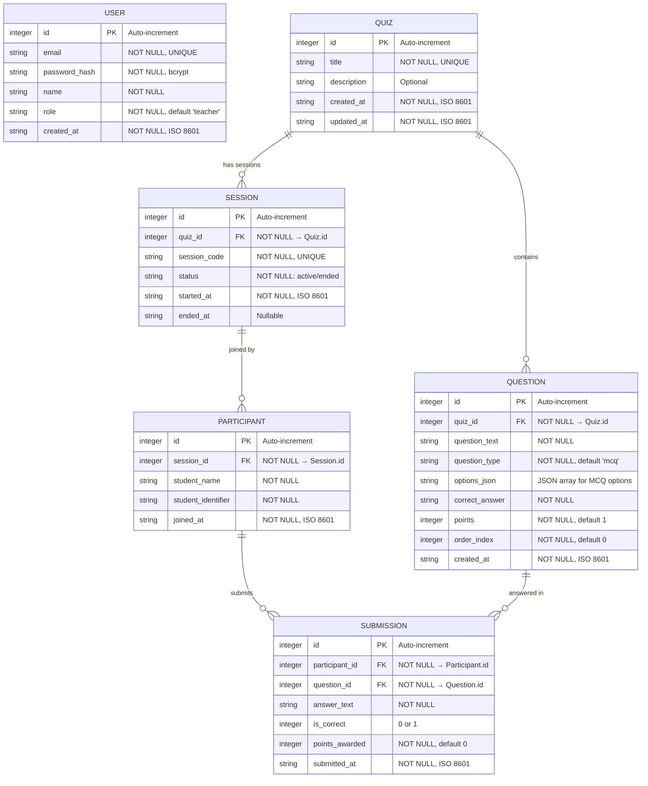

# Database Design

**Project:** Online Quiz System — Q06: Reduce Duplicate Entries  
**Version:** 2.0 | **Date:** 2026-11-16  
**Persist Engine:** SQLAlchemy 2.0 ORM (PostgreSQL Production / SQLite Development)  
**Migrations:** Alembic  

---

## 1. Entity-Relationship Diagram

---

## 2. Table Definitions

### 2.1 users (Teacher / Administrator Authentication)

| Column | Type | Constraints | Notes |
|--------|------|-------------|-------|
| id | INTEGER | PRIMARY KEY AUTOINCREMENT | Unique user identifier |
| email | VARCHAR(255) | NOT NULL, UNIQUE, INDEX | Login email address |
| password_hash | VARCHAR(255) | NOT NULL | One-way salted hash (bcrypt) |
| name | VARCHAR(200) | NOT NULL | Display name of the instructor |
| role | VARCHAR(20) | NOT NULL, DEFAULT 'teacher' | 'teacher' or 'admin' |
| created_at | VARCHAR(50) | NOT NULL | ISO 8601 timestamp |

**Index:** `ix_users_email` (UNIQUE).

---

### 2.2 quizzes

| Column | Type | Constraints | Notes |
|--------|------|-------------|-------|
| id | INTEGER | PRIMARY KEY AUTOINCREMENT | Unique quiz identifier |
| title | VARCHAR(200) | NOT NULL, UNIQUE, INDEX | Quiz title; globally unique to prevent duplicate quiz entries (Q06) |
| description | TEXT | NULLABLE | Optional quiz instructions/description |
| created_at | VARCHAR(50) | NOT NULL | ISO 8601 timestamp |
| updated_at | VARCHAR(50) | NOT NULL | ISO 8601 timestamp, updated on modification |

**Index:** `ix_quizzes_title` (UNIQUE).

---

### 2.3 questions

| Column | Type | Constraints | Notes |
|--------|------|-------------|-------|
| id | INTEGER | PRIMARY KEY AUTOINCREMENT | Unique question identifier |
| quiz_id | INTEGER | NOT NULL, FK → quizzes(id) ON DELETE CASCADE | Parent quiz reference |
| question_text | TEXT | NOT NULL | Prompt of the assessment item |
| question_type | VARCHAR(50) | NOT NULL, DEFAULT 'mcq' | 'mcq', 'true_false', or 'short_answer' |
| options_json | TEXT | NULLABLE | JSON array string, e.g. `["Option A", "Option B"]` |
| correct_answer | VARCHAR(500) | NOT NULL | Answer string evaluated by grading engine |
| points | INTEGER | NOT NULL, DEFAULT 1 | Weight awarded for correct response |
| order_index | INTEGER | NOT NULL, DEFAULT 0 | Display sequence in quiz |
| created_at | VARCHAR(50) | NOT NULL | ISO 8601 timestamp |

**Index:** `ix_questions_quiz_id`  
**Composite Unique Constraint:** `uq_quiz_question_text` on `(quiz_id, question_text)` — prevents inserting duplicate question prompts into the same quiz (Q06).

---

### 2.4 sessions

| Column | Type | Constraints | Notes |
|--------|------|-------------|-------|
| id | INTEGER | PRIMARY KEY AUTOINCREMENT | Unique session identifier |
| quiz_id | INTEGER | NOT NULL, FK → quizzes(id) ON DELETE CASCADE | Target quiz being administered |
| session_code | VARCHAR(50) | NOT NULL, UNIQUE, INDEX | Unique join code (e.g. `MATH-7X3K`) |
| status | VARCHAR(20) | NOT NULL, DEFAULT 'active' | 'active' or 'ended' |
| started_at | VARCHAR(50) | NOT NULL | ISO 8601 timestamp |
| ended_at | VARCHAR(50) | NULLABLE | Timestamp when session was terminated |

**Index:** `ix_sessions_quiz_id`, `ix_sessions_session_code` (UNIQUE).

---

### 2.5 participants

| Column | Type | Constraints | Notes |
|--------|------|-------------|-------|
| id | INTEGER | PRIMARY KEY AUTOINCREMENT | Unique participant record |
| session_id | INTEGER | NOT NULL, FK → sessions(id) ON DELETE CASCADE | Associated assessment session |
| student_name | VARCHAR(200) | NOT NULL | Student's full name |
| student_identifier | VARCHAR(100) | NOT NULL | Unique roll number / student ID |
| joined_at | VARCHAR(50) | NOT NULL | ISO 8601 timestamp |

**Index:** `ix_participants_session_id`  
**Composite Unique Constraint:** `uq_session_participant` on `(session_id, student_identifier)` — guarantees a student cannot enter or take the same session twice (Q06).

---

### 2.6 submissions

| Column | Type | Constraints | Notes |
|--------|------|-------------|-------|
| id | INTEGER | PRIMARY KEY AUTOINCREMENT | Unique submission record |
| participant_id | INTEGER | NOT NULL, FK → participants(id) ON DELETE CASCADE | Associated student participant |
| question_id | INTEGER | NOT NULL, FK → questions(id) ON DELETE CASCADE | Target question |
| answer_text | TEXT | NOT NULL | Student's submitted response |
| is_correct | INTEGER | NULLABLE | 0 = incorrect, 1 = correct |
| points_awarded | INTEGER | NOT NULL, DEFAULT 0 | Points earned |
| submitted_at | VARCHAR(50) | NOT NULL | ISO 8601 timestamp |

**Index:** `ix_submissions_participant_id`, `ix_submissions_question_id`  
**Composite Unique Constraint:** `uq_participant_question` on `(participant_id, question_id)` — strictly prevents duplicate submissions for the same question by the same participant (Q06).

---

## 3. Relational Cascading Rules

| Parent Record Deleted | Cascade Effect on Dependents |
|----------------------|------------------------------|
| **User** | Retained or transferred (manual audit trail) |
| **Quiz** | Cascades delete to all child `questions` and child `sessions` |
| **Session** | Cascades delete to all child `participants` and their `submissions` |
| **Question** | Cascades delete to all child `submissions` referencing that question |
| **Participant** | Cascades delete to all child `submissions` by that participant |

*Implementation:* Configured at both ORM level (`cascade="all, delete-orphan"`) and DDL level (`ondelete="CASCADE"`). In SQLite environments, `PRAGMA foreign_keys = ON` is automatically activated on every connection via engine event hooks.

---

## 4. Q06 Anti-Duplicate Defense Architecture

| Tier | Quality Defense Layer | Database / Persist Implementation |
|------|-----------------------|-----------------------------------|
| **Tier 1 (Storage)** | Primary & Unique Keys | `ix_quizzes_title`, `ix_users_email`, `ix_sessions_session_code`, `uq_quiz_question_text`, `uq_session_participant`, `uq_participant_question`. |
| **Tier 2 (Schema/Validation)** | Pydantic Models | String whitespace stripping, non-empty validation, option inclusion tests in `backend/models.py`. |
| **Tier 3 (Service Layer)** | Search-Before-Add | Explicit check queries (`get_quiz_by_title`, `get_question_by_text_in_quiz`) raising HTTP 409 Conflict prior to executing `INSERT`. |
| **Tier 4 (Presentation)** | Poka-Yoke Dialogs | Confirmation modals and client-side form validation before dispatching submission payloads. |

---

## 5. Migration Management with Alembic

Database migrations are tracked under `alembic/versions/` using declarative autogeneration:
- Initial Schema Revision: `5280994aae39_initial_schema_with_users.py`
- Configuration: `alembic.ini` configured with `render_as_batch=True` to support SQLite column and constraint modifications without engine lockup.
- Execution Command: `alembic upgrade head`
