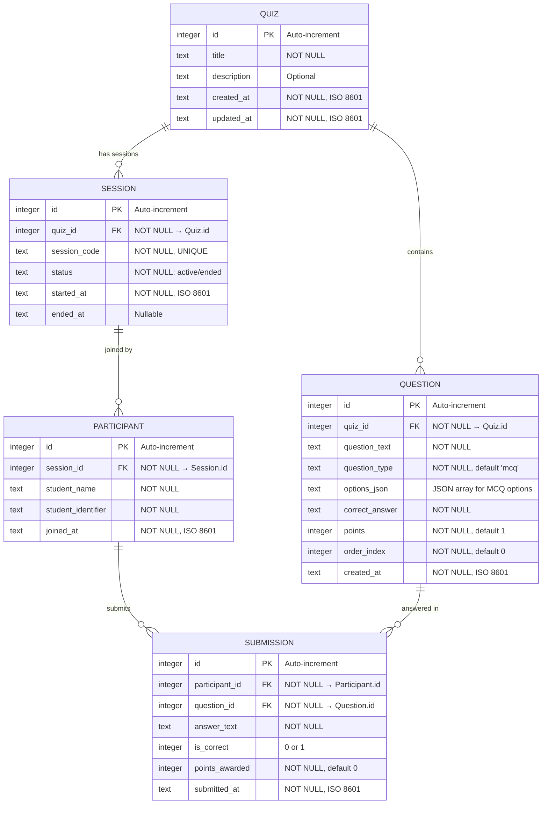

# Database Design

**Project:** Online Quiz System — Q06: Reduce Duplicate Entries
**Version:** 1.0 | **Date:** 2026-10-11

---

## 1. Entity-Relationship Diagram

---

## 2. Table Definitions

### 2.1 quizzes

| Column | Type | Constraints | Notes |
|--------|------|-------------|-------|
| id | INTEGER | PRIMARY KEY AUTOINCREMENT | Unique quiz identifier |
| title | TEXT | NOT NULL, UNIQUE | Quiz title; globally unique to prevent duplicate quiz entries (Q06) |
| description | TEXT | — | Optional quiz description |
| created_at | TEXT | NOT NULL | ISO 8601 timestamp |
| updated_at | TEXT | NOT NULL | ISO 8601 timestamp, updated on modification |

### 2.2 questions

| Column | Type | Constraints | Notes |
|--------|------|-------------|-------|
| id | INTEGER | PRIMARY KEY AUTOINCREMENT | Unique question identifier |
| quiz_id | INTEGER | NOT NULL, FK → quizzes(id) ON DELETE CASCADE | Parent quiz |
| question_text | TEXT | NOT NULL | The question prompt |
| question_type | TEXT | NOT NULL, DEFAULT 'mcq' | 'mcq' initially; extensible to 'true_false', 'short_answer' |
| options_json | TEXT | — | JSON-encoded array, e.g., `["A", "B", "C", "D"]` |
| correct_answer | TEXT | NOT NULL | Expected correct answer |
| points | INTEGER | NOT NULL, DEFAULT 1 | Points awarded for correct answer |
| order_index | INTEGER | NOT NULL, DEFAULT 0 | Display order within the quiz |
| created_at | TEXT | NOT NULL | ISO 8601 timestamp |

**Index:** `CREATE INDEX idx_questions_quiz_id ON questions(quiz_id);`

### 2.3 sessions

| Column | Type | Constraints | Notes |
|--------|------|-------------|-------|
| id | INTEGER | PRIMARY KEY AUTOINCREMENT | Unique session identifier |
| quiz_id | INTEGER | NOT NULL, FK → quizzes(id) ON DELETE CASCADE | Which quiz this session is for |
| session_code | TEXT | NOT NULL, UNIQUE | Human-readable join code (e.g., "QUIZ-7X3K") |
| status | TEXT | NOT NULL, DEFAULT 'active' | 'active' or 'ended' |
| started_at | TEXT | NOT NULL | ISO 8601 timestamp |
| ended_at | TEXT | — | Set when session is ended |

### 2.4 participants

| Column | Type | Constraints | Notes |
|--------|------|-------------|-------|
| id | INTEGER | PRIMARY KEY AUTOINCREMENT | Unique participant identifier |
| session_id | INTEGER | NOT NULL, FK → sessions(id) ON DELETE CASCADE | Which session they joined |
| student_name | TEXT | NOT NULL | Display name |
| student_identifier | TEXT | NOT NULL | Roll number or unique ID |
| joined_at | TEXT | NOT NULL | ISO 8601 timestamp |

**Unique constraint:** `UNIQUE(session_id, student_identifier)` — prevents same student joining a session twice.

### 2.5 submissions

| Column | Type | Constraints | Notes |
|--------|------|-------------|-------|
| id | INTEGER | PRIMARY KEY AUTOINCREMENT | Unique submission identifier |
| participant_id | INTEGER | NOT NULL, FK → participants(id) ON DELETE CASCADE | Who submitted |
| question_id | INTEGER | NOT NULL, FK → questions(id) ON DELETE CASCADE | Which question |
| answer_text | TEXT | NOT NULL | Student's answer |
| is_correct | INTEGER | — | 0 = incorrect, 1 = correct (set by grading) |
| points_awarded | INTEGER | NOT NULL, DEFAULT 0 | Points awarded |
| submitted_at | TEXT | NOT NULL | ISO 8601 timestamp |

**Unique constraint:** `UNIQUE(participant_id, question_id)` — one submission per question per participant.

---

## 3. Deletion Behaviour

| Parent Deleted | Cascade Effect |
|---------------|----------------|
| Quiz | → All its Questions, Sessions (and their Participants, Submissions) |
| Session | → All its Participants (and their Submissions) |
| Question | → All Submissions referencing that question |
| Participant | → All their Submissions |

Foreign key enforcement requires `PRAGMA foreign_keys = ON` in SQLite.

---

## 4. Q06 Constraints Summary

| Q06 Feature | Database Implementation |
|-------------|----------------------|
| Unique ID Constraints | PK on all tables; UNIQUE on session_code; UNIQUE(session_id, student_identifier); UNIQUE(participant_id, question_id) |
| Pre-add Validation | NOT NULL constraints; enforced additionally in service layer |
| Search Before Add | Service queries before INSERT; database constraints as final guard |
| Confirmation Dialogs | Client-side only; no database involvement |
