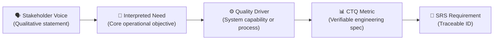
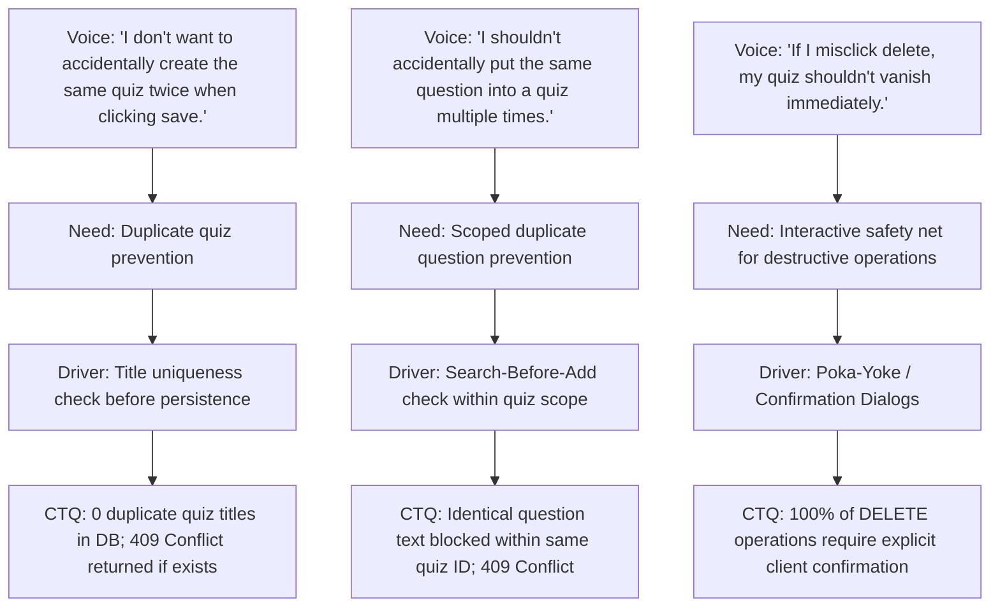
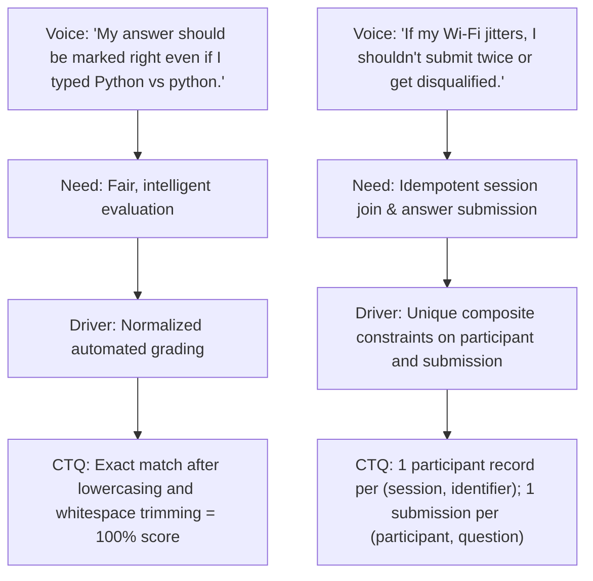

# Voice of the Stakeholder (VoS) & CTQ Translation

**Course:** BBAT104 — Fundamentals of Total Quality Management (TQM)  
**Academic Session:** 2026–27  
**Student:** Saksham Singh Saloni (Roll No: AU-24-5271)  
**Project Baseline:** Baseline No. 9 — Online Quiz System  
**Assigned Quality Goal:** Q06 — Reduce Duplicate Entries  
**Document Version:** 1.0  
**Date:** 2026-11-16  

---

## 1. Introduction & TQM Methodology

In Total Quality Management (TQM) and Six Sigma frameworks, product excellence begins with listening to the **Voice of the Customer (VoC)** and **Voice of the Stakeholder (VoS)**. Stakeholders articulate requirements in informal, natural language ("raw voices"). If systems are built directly on raw, ambiguous statements, defects and scope drift inevitably occur.

The TQM approach systematically converts qualitative customer voices into quantitative, verifiable engineering requirements using the **Critical to Quality (CTQ) Flowdown**:

This document executes **Stage 2** of the project pipeline, directly consuming the 6 stakeholders identified in Stage 1 (`SH-01` through `SH-06`) and translating their voices into traceable quality requirements.

---

## 2. Voice to CTQ Translation Matrices

### 2.1 SH-01: Teacher / Quiz Conductor (Primary Internal Customer)

| VoS ID | Stakeholder | Raw Voice Statement | Interpreted Need | Quality Driver | CTQ Metric / Specification | Target SRS ID |
| :--- | :--- | :--- | :--- | :--- | :--- | :--- |
| **VoS-01** | SH-01 (Teacher) | *"I don't want to accidentally create the same quiz twice when clicking save."* | Prevent duplicate quiz entries. | Search Before Add + DB Unique constraint. | Title collision check (case-insensitive, trimmed). HTTP 409 returned on collision. $0$ duplicate quiz titles allowed. | `FR-Q1`, `FR-Q3`, `FR-01` |
| **VoS-02** | SH-01 (Teacher) | *"I shouldn't accidentally put the same question into a quiz multiple times."* | Prevent duplicate questions within a quiz. | Composite uniqueness validation. | Search before adding question to quiz. Duplicate question text in the same `quiz_id` rejected with 409. | `FR-Q1`, `FR-Q3`, `FR-05` |
| **VoS-03** | SH-01 (Teacher) | *"If I misclick delete, my entire quiz shouldn't vanish without warning."* | Error-proofing against accidental data deletion. | Poka-Yoke confirmation dialogs. | Every delete request must be preceded by an interactive prompt requiring user confirmation. | `FR-Q4`, `FR-04`, `FR-08` |
| **VoS-04** | SH-01 (Teacher) | *"I need to see how many questions are in each quiz at a glance."* | Intuitive assessment management. | Aggregate reporting in list views. | Quiz list view displays real-time question count and creation timestamps. | `FR-02` |
| **VoS-18** | SH-01 (Teacher) | *"I need to view my teaching impact metrics, keep my profile name up to date, and maintain secure account credentials."* | Instructor profile, teaching analytics, and credential management. | Authenticated profile dashboard and Tier 2 validated updates. | Profile view renders accurate live stats; display name updates sanitize whitespace; password updates verify current credentials. | `FR-15` |

---

### 2.2 SH-02: Student / Participant (Primary External Customer)

| VoS ID | Stakeholder | Raw Voice Statement | Interpreted Need | Quality Driver | CTQ Metric / Specification | Target SRS ID |
| :--- | :--- | :--- | :--- | :--- | :--- | :--- |
| **VoS-05** | SH-02 (Student) | *"My answer should be counted correct even if I used different capital letters or accidental spaces."* | Case-insensitive and whitespace-tolerant grading. | Robust string normalization algorithm. | Grading normalizes both expected and submitted answers: $\text{strip}(s).\text{lower}()$. False negatives $= 0\%$. | `NFR-03`, `FR-12` |
| **VoS-06** | SH-02 (Student) | *"If my internet lags and I double-click submit, I shouldn't get an error or duplicate score."* | Submission idempotency; duplicate join prevention. | Database composite uniqueness. | Enforce `UNIQUE(session_id, student_identifier)` and `UNIQUE(participant_id, question_id)`. Re-submits handled gracefully. | `FR-Q1`, `FR-10`, `FR-11` |
| **VoS-07** | SH-02 (Student) | *"I want to see my score and which questions I got right as soon as I finish."* | Immediate, transparent performance feedback. | Automated result calculation. | Score and question-by-question breakdown available immediately upon submission. | `FR-13` |

---

### 2.3 SH-03: Professor / Course Evaluator (Sponsor & Quality Auditor)

| VoS ID | Stakeholder | Raw Voice Statement | Interpreted Need | Quality Driver | CTQ Metric / Specification | Target SRS ID |
| :--- | :--- | :--- | :--- | :--- | :--- | :--- |
| **VoS-08** | SH-03 (Professor) | *"Follow the TQM pipeline sequentially: Stakeholders $\rightarrow$ Voices $\rightarrow$ SRS $\rightarrow$ Web App $\rightarrow$ Tests."* | Methodological rigor and process traceability. | TQM Pipeline adherence. | $100\%$ bidirectional traceability matrix linking every Voice to SRS, Code, and Test. | `Stage 1–8`, `SRS §9` |
| **VoS-09** | SH-03 (Professor) | *"Every test result must be documented to feed real defect data into FMEA and Pareto charts."* | Empirical data collection for statistical quality tools. | Defect logging & automated reporting. | Automated test logs export to JUnit XML; manual test log records severity, root cause, and status for $100\%$ of defects. | `Stage 6–7`, `docs/testing.md` |
| **VoS-10** | SH-03 (Professor) | *"Demonstrate that all Q06 duplicate reduction features actually work through automated tests."* | Objective verification of assigned quality goal. | Automated test suite execution. | $100\%$ pass rate on unit/integration test suite covering all 4 Q06 features with execution time $< 2.0\text{s}$. | `FR-Q1`–`FR-Q4`, `tests/` |

---

### 2.4 SH-04: University / Academic Institution (Governance & Compliance)

| VoS ID | Stakeholder | Raw Voice Statement | Interpreted Need | Quality Driver | CTQ Metric / Specification | Target SRS ID |
| :--- | :--- | :--- | :--- | :--- | :--- | :--- |
| **VoS-11** | SH-04 (University) | *"Assessment data must remain consistent and untampered with; deleting a quiz must not leave orphaned questions."* | Relational referential integrity and audit compliance. | Foreign key constraints with cascade deletes. | `PRAGMA foreign_keys = ON` in SQLite / PostgreSQL FK constraints. Orphaned records $= 0$. | `NFR-01`, `database-design` |
| **VoS-12** | SH-04 (University) | *"System timestamps must record exactly when quizzes are authored and submitted."* | Chronological audit trail. | ISO 8601 UTC timestamps. | All tables include non-nullable `created_at` / `submitted_at` in standardized ISO format. | `NFR-02` |

---

### 2.5 SH-05: Software Developer (Internal Maintainer)

| VoS ID | Stakeholder | Raw Voice Statement | Interpreted Need | Quality Driver | CTQ Metric / Specification | Target SRS ID |
| :--- | :--- | :--- | :--- | :--- | :--- | :--- |
| **VoS-13** | SH-05 (Developer) | *"The codebase should have clean separation so UI changes don't break database queries or business rules."* | Maintainable, decoupled system architecture. | Three-tier architecture (API $\rightarrow$ Service $\rightarrow$ Repository). | Service layer contains zero SQL; Repository layer contains zero UI logic. Modules tested in isolation. | `NFR-04`, `architecture` |
| **VoS-14** | SH-05 (Developer) | *"Input validation should catch bad data at the boundary before it hits the database."* | Robust defensive programming (Pre-add validation). | Pydantic schema validation. | Empty titles, invalid MCQ option counts ($<2$ or $>6$), or correct answers missing from options rejected with 422 before DB call. | `FR-Q2`, `backend/models.py` |

---

### 2.6 SH-06: System Administrator / DevOps (Support & Operations)

| VoS ID | Stakeholder | Raw Voice Statement | Interpreted Need | Quality Driver | CTQ Metric / Specification | Target SRS ID |
| :--- | :--- | :--- | :--- | :--- | :--- | :--- |
| **VoS-15** | SH-06 (SysAdmin) | *"The system must handle multiple concurrent student submissions during an exam without database file-lock errors."* | Concurrency and multi-user scalability. | Production-grade RDBMS with connection pooling. | Database engine supports concurrent row-level writes (PostgreSQL + SQLAlchemy pooling). Write timeouts $= 0$. | `NFR-05`, `ADR-002` |
| **VoS-16** | SH-06 (SysAdmin) | *"Database schema changes must be reproducible and automated across environments."* | Version-controlled schema management. | Database migration framework. | All DDL managed through Alembic migration scripts (`alembic upgrade head`). Manual SQL scripts on prod $= 0$. | `NFR-06`, `alembic/` |
| **VoS-17** | SH-06 (SysAdmin) | *"I need a health-check endpoint to verify backend availability and uptime."* | Operational observability. | System health probes. | `GET /` returns `200 OK` with service name, status, and OpenAPI `/docs` link within $< 50\text{ms}$. | `NFR-07`, `backend/main.py` |

---

## 3. Master VoS-to-SRS Requirements Traceability Summary

The table below unifies all 17 analyzed stakeholder voices (`VoS-01` to `VoS-17`) into a reference mapping for the upcoming **Stage 3: Rebuild SRS**:

| Voice ID | Originating Stakeholder | Core Quality Need | Assigned SRS Requirement ID |
| :--- | :--- | :--- | :--- |
| **VoS-01** | SH-01 (Teacher) | Duplicate quiz prevention | `FR-Q1`, `FR-Q3`, `FR-01` |
| **VoS-02** | SH-01 (Teacher) | Scoped duplicate question prevention | `FR-Q1`, `FR-Q3`, `FR-05` |
| **VoS-03** | SH-01 (Teacher) | Interactive deletion confirmation | `FR-Q4`, `FR-04`, `FR-08` |
| **VoS-04** | SH-01 (Teacher) | Overview quiz statistics | `FR-02` |
| **VoS-05** | SH-02 (Student) | Case-insensitive & normalized grading | `NFR-03`, `FR-12` |
| **VoS-06** | SH-02 (Student) | Idempotent joins & submissions | `FR-Q1`, `FR-10`, `FR-11` |
| **VoS-07** | SH-02 (Student) | Instant result transparency | `FR-13` |
| **VoS-08** | SH-03 (Professor) | TQM pipeline compliance | `Stage 1–8`, `SRS §9` |
| **VoS-09** | SH-03 (Professor) | Test logging for FMEA/Pareto | `Stage 6–7`, `docs/testing.md` |
| **VoS-10** | SH-03 (Professor) | Automated Q06 test verification | `FR-Q1`–`FR-Q4`, `tests/` |
| **VoS-11** | SH-04 (University) | Cascade integrity & zero orphans | `NFR-01` |
| **VoS-12** | SH-04 (University) | Chronological audit timestamps | `NFR-02` |
| **VoS-13** | SH-05 (Developer) | Layered decoupling | `NFR-04` |
| **VoS-14** | SH-05 (Developer) | Pre-add boundary validation | `FR-Q2` |
| **VoS-15** | SH-06 (SysAdmin) | Concurrent multi-user persistence | `NFR-05`, `ADR-002` |
| **VoS-16** | SH-06 (SysAdmin) | Reproducible Alembic migrations | `NFR-06` |
| **VoS-17** | SH-06 (SysAdmin) | Uptime health check endpoint | `NFR-07` |

---

## 4. Next Step: Stage 3 (Rebuild SRS From Voices)

With **Stage 2** complete, every requirement in the project now has an empirical origin anchored to a stakeholder voice. 

In **Stage 3**, we will modify `docs/SRS.md` to:
1. Embed the formal stakeholder references (`SH-01` to `SH-06`).
2. Add a **"Source Voice"** column to every Functional and Non-Functional Requirement table.
3. Build the expanded **End-to-End Traceability Matrix** ($\text{Voice} \rightarrow \text{Requirement} \rightarrow \text{Code Module} \rightarrow \text{Test Case} \rightarrow \text{Defect Log}$).
