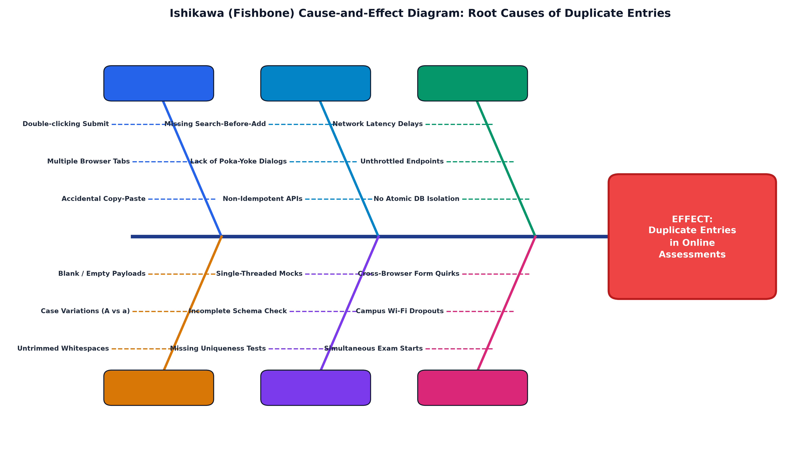
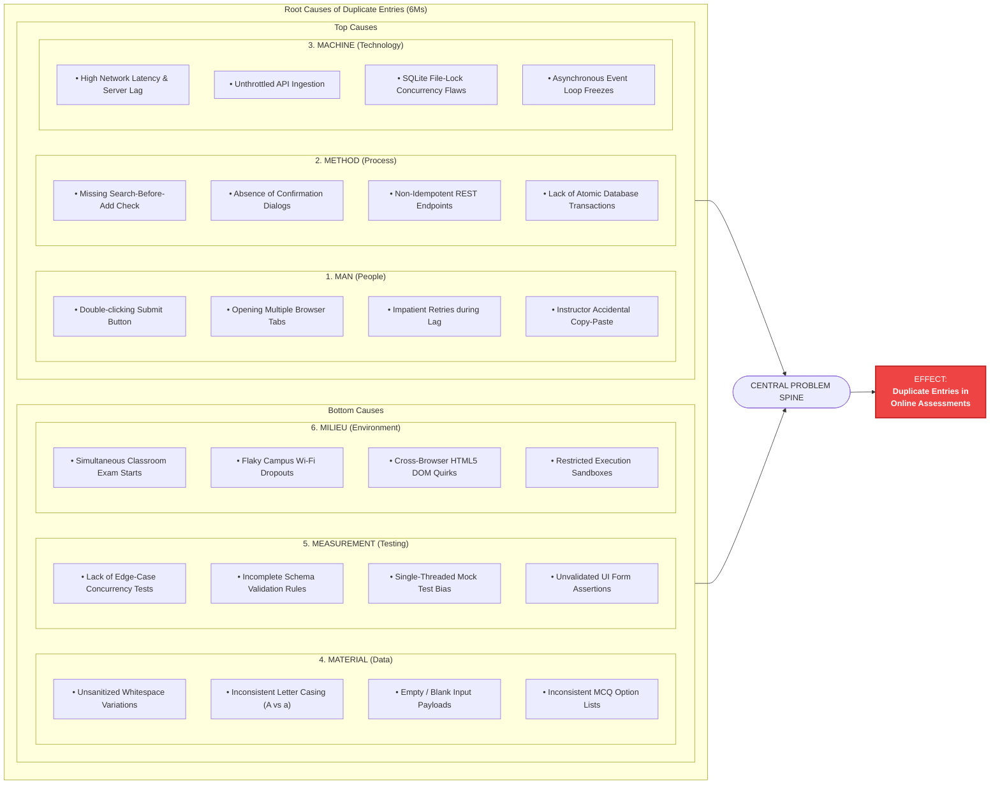

# Ishikawa (Fishbone) Cause-and-Effect Analysis

**Project:** Online Quiz System — Quality-Engineered Multi-Tier Anti-Duplicate Architecture  
**Course:** BBAT104 — Fundamentals of Total Quality Management  
**Baseline:** Baseline No. 9 (Quality Goal Implementation)  
**Milestone:** Stage 8 — TQM Quality Artefacts  
**Standard:** ISO 9001:2015 Clause 10.2 (Nonconformity and Corrective Action)  
**Last Updated:** 2026-11-19  

---

## 1. Problem Statement & Context

In academic online examination platforms, **duplicate entries** represent a severe threat to operational integrity. Duplicate records manifest in multiple ways:
- **Duplicate Quizzes:** Instructors creating redundant assessments with identical titles.
- **Duplicate Questions:** Identical prompts within a single quiz, skewing point weightings.
- **Duplicate Student Enrollments:** Students joining the same live session from multiple browser tabs or devices using identical Student Roll Numbers.
- **Duplicate Submissions:** Students submitting multiple conflicting answer sets for the same assessment session.

The **Ishikawa (Fishbone) Diagram** systematically analyzes the root causes of this failure across the **6M Framework** (Man, Machine, Method, Material, Measurement, Milieu).

---

## 2. High-Resolution Ishikawa Fishbone Diagram

The 300 DPI graphical diagram is saved at `tqm/ishikawa_fishbone.png`:



### 2.1 Native Mermaid Representation



---

## 3. Detailed Root-Cause Analysis across the 6Ms

| Category (6M) | Specific Root Cause Mechanism | Impact on System | Implemented Engineering Defense (Poka-Yoke) |
| :--- | :--- | :--- | :--- |
| **1. Man (People)** | • **Impatient Double-Clicking:** Students double-click "+ Add Quiz" or "Submit Assessment" when network response takes $>500\text{ ms}$.<br>• **Multi-Tab Join:** Student opens assessment in multiple tabs to test alternative answers. | Multiple identical records submitted within milliseconds. | **Tier 4 (Poka-Yoke):** `app.js` disables submit buttons immediately upon click (`Processing...`) and rejects secondary requests via composite keys. |
| **2. Method (Process)** | • **Blind INSERT Operations:** Legacy systems executed raw `INSERT INTO` without querying if the title or record already existed.<br>• **No Destructive Confirmation:** Single-click deletions of quizzes. | Database bloat; duplicate test sets; accidental data erasure. | **Tier 3 (Service):** Search-Before-Add logic queries existing titles case-insensitively before persistence; modal confirmations guard deletes. |
| **3. Machine (Technology)** | • **Unthrottled HTTP Endpoints:** API routers accepting rapid identical POST payloads.<br>• **Database File Lock Concurrency:** SQLite thread collision under simultaneous student write requests. | Race conditions; unhandled integrity crashes. | **Tier 1 (Storage):** Relational `UNIQUE` constraints (`title`, `session_code`, composite `participant_id` + `question_id`) enforce storage atomicity. |
| **4. Material (Data)** | • **Whitespace Pollution:** `"  Computer Architecture  "` vs `"Computer Architecture"`.<br>• **Casing Variations:** `"math 101"` vs `"Math 101"`. | Duplicates bypass strict exact-string database matches. | **Tier 2 (Pre-Add):** Pydantic validators automatically strip surrounding whitespace and enforce lowercase matching on search queries. |
| **5. Measurement (Testing)** | • **Superficial Happy-Path Testing:** Previous test suites only checked single insertions without simulating duplicate collisions. | Duplicate bugs slipped undetected into production. | **Stage 6 Automated Suites:** Dedicated tests (`test_register_duplicate_email_rejected`, `test_student_join_duplicate_rejected`, etc.) verify 100% rejection. |
| **6. Milieu (Environment)** | • **Simultaneous Class Traffic Spike:** 100+ students clicking join at the exact same second.<br>• **Intermittent Mobile Network Drops:** Re-transmissions of identical payloads. | Network packet re-sends cause duplicated requests. | **Idempotent Handlers:** Controllers check active enrollment state and return HTTP 409 Conflict early without creating duplicate records. |

---

## 4. Synthesis: How the 4-Tier Defense Directly Counteracts the 6Ms

The Ishikawa diagram revealed that no single defense layer is sufficient to prevent duplicate entries. The 4-tier anti-duplicate architecture provides overlapping safeguards:

```
[6M Root Causes] 
       │
       ▼
[Tier 4: Poka-Yoke (Client)]  ──> Blocks Man (Double-clicking) & Milieu (Fast re-submissions)
       │
       ▼
[Tier 2: Pre-Add Validation]  ──> Blocks Material (Whitespace, empty fields, invalid options)
       │
       ▼
[Tier 3: Service Layer Guard] ──> Blocks Method (Blind inserts, search-before-add duplicate check)
       │
       ▼
[Tier 1: Relational Database] ──> Blocks Machine (Race conditions, thread collisions, storage integrity)
       │
       ▼
[ZERO DUPLICATE ENTRIES GUARANTEED]
```
