# Failure Mode and Effects Analysis (FMEA)

**Project:** Online Quiz System — Quality-Engineered Multi-Tier Anti-Duplicate Architecture  
**Course:** BBAT104 — Fundamentals of Total Quality Management  
**Baseline:** Baseline No. 9 (Quality Goal Implementation)  
**Milestone:** Stage 8 — TQM Quality Artefacts  
**Standard:** AIAG & VDA FMEA Handbook (Design & Process FMEA)  
**Last Updated:** 2026-11-19  

---

## 1. FMEA Methodology & Scoring Criteria

Failure Mode and Effects Analysis (FMEA) is a systematic, proactive quality technique used to identify potential failure modes, evaluate their causes and effects, and prioritize risk mitigations.

### 1.1 Risk Priority Number (RPN) Formula
The critical metric is the **Risk Priority Number (RPN)**:
$$\text{RPN} = \text{Severity } (S) \times \text{Occurrence } (O) \times \text{Detection } (D)$$

### 1.2 Evaluation Scales (1 to 10)

| Rating | Severity ($S$) | Occurrence ($O$) | Detection ($D$) |
| :---: | :--- | :--- | :--- |
| **1** | **None:** No effect on user experience. | **Extremely Rare:** $< 1$ in $100,000$ operations. | **Almost Certain:** Automated unit tests catch $100\%$. |
| **2–3** | **Minor:** Slight customer annoyance; simple retry. | **Low:** Rare intermittent occurrence ($1$ in $10,000$). | **High:** Unit & integration test suites detect early. |
| **4–6** | **Moderate:** Operation fails; requires manual restart. | **Medium:** Occasional occurrence ($1$ in $1,000$). | **Moderate:** Detected during integration or QA phase. |
| **7–8** | **High:** Primary feature blocked; data corruption. | **High:** Frequent occurrence under normal usage. | **Low:** Difficult to catch; requires manual user report. |
| **9–10** | **Catastrophic:** System crash, integrity breach, exam failure. | **Very High:** Almost inevitable without controls. | **Undetectable:** Silently reaches production unlogged. |

---

## 2. Comprehensive FMEA Matrix

The following table evaluates the 8 critical failure modes of the assessment system **before mitigation (Baseline)** and **after implementing the 4-Tier Anti-Duplicate Architecture (Post-Mitigation)**:

| ID | Process Function | Potential Failure Mode | Potential Effect of Failure | Potential Cause of Failure | Pre $S$ | Pre $O$ | Pre $D$ | **Pre RPN** | Implemented Quality Controls (4-Tier Defense) | Post $S$ | Post $O$ | Post $D$ | **Post RPN** | **$\Delta$ RPN Reduction** |
| :---: | :--- | :--- | :--- | :--- | :---: | :---: | :---: | :---: | :--- | :---: | :---: | :---: | :---: | :---: |
| **FM-01** | Quiz Authoring | Duplicate Quiz Title created | Redundant quizzes; instructors launch wrong test version; student confusion. | Lack of uniqueness check; concurrent teacher authoring. | 6 | 7 | 6 | **252** | **Tier 1:** `UNIQUE(title)` DB constraint.<br>**Tier 2:** Pydantic title sanitization.<br>**Tier 3:** Case-insensitive search-before-add. | 3 | 1 | 1 | **3** | **$-98.8\%$** |
| **FM-02** | Question Authoring | Duplicate Question Prompt in same quiz | Skewed exam scoring; duplicate questions waste student exam time. | Rapid clicking; accidental duplicate copy-paste. | 6 | 6 | 6 | **216** | **Tier 1:** `UNIQUE(quiz_id, question_text)`.<br>**Tier 2:** Whitespace stripping.<br>**Tier 3:** Search-before-add in parent quiz. | 3 | 1 | 1 | **3** | **$-98.6\%$** |
| **FM-03** | Session Registration | Duplicate Student Enrollment (Same Roll No.) | One student joins twice from multiple browsers; grade conflicts. | Impatient join retries; multiple active browser tabs. | 8 | 8 | 5 | **320** | **Tier 1:** Composite `UNIQUE(session_id, student_identifier)`.<br>**Tier 3:** Active participant check (HTTP 409). | 4 | 1 | 1 | **4** | **$-98.8\%$** |
| **FM-04** | Assessment Submission | Duplicate Answer Submission | Skewed student leaderboard; race condition in score aggregation. | Double-clicking submit during network latency. | 7 | 8 | 6 | **336** | **Tier 1:** `Submission(participant_id, question_id)` PK.<br>**Tier 3:** Submission state guard.<br>**Tier 4:** Client double-submit blocker. | 4 | 1 | 1 | **4** | **$-98.8\%$** |
| **FM-05** | Question Management | Inconsistent MCQ Options / Missing Answer Key | Exam cannot be graded correctly; auto-grader crashes or assigns 0. | Instructor defines answer not listed among choices. | 8 | 6 | 7 | **336** | **Tier 2:** Pydantic model validator enforces `correct_answer in options` before DB write. | 3 | 1 | 1 | **3** | **$-99.1\%$** |
| **FM-06** | Assessment Delivery | Academic Compromise via Payload Inspection | Students inspect browser network tab to view correct answers before submitting. | Backend endpoint leaks `correct_answer` in session delivery payload. | 9 | 7 | 8 | **504** | **Data Isolation Tier:** `SessionService.get_session_questions` explicitly strips `correct_answer`. | 2 | 1 | 1 | **2** | **$-99.6\%$** |
| **FM-07** | Automated Grading | False Negative on Valid Short Answer | Unfair penalization of correct student answers; grade disputes. | Case mismatch (`python` vs `Python`) or trailing spaces. | 7 | 8 | 7 | **392** | **Poka-Yoke Grading:** Case-insensitive string normalization & automatic whitespace stripping. | 2 | 1 | 1 | **2** | **$-99.5\%$** |
| **FM-08** | System Admin | Accidental Deletion of Live Quiz / Questions | Total loss of active session data and completed student submissions. | Accidental click on delete button without warning. | 9 | 6 | 5 | **270** | **Tier 4 (Poka-Yoke):** Intercepting confirmation modal (`data-confirm`) requires explicit confirmation. | 3 | 1 | 2 | **6** | **$-97.8\%$** |

---

## 3. Quantitative Risk Reduction Analysis

### 3.1 RPN Summary Comparison

```
Baseline Total RPN:     2,626
Post-Mitigation Total:     27
=====================================================
Overall Risk Reduction:  98.97%
Average Pre-RPN:          328.3
Average Post-RPN:           3.4
```



```mermaid
xychart-beta
    title "Failure Mode Risk Priority Number (RPN) Comparison"
    x-axis ["FM-01", "FM-02", "FM-03", "FM-04", "FM-05", "FM-06", "FM-07", "FM-08"]
    y-axis "Risk Priority Number (RPN)" 0 --> 550
    bar [252, 216, 320, 336, 336, 504, 392, 270]
    bar [3, 3, 4, 4, 3, 2, 2, 6]
```

### 3.2 Key Quality Engineering Findings

1. **Highest Initial Risk Mode (FM-06 — Answer Key Leakage):**
   - **Pre-RPN = 504:** Severe academic integrity impact ($S=9$) combined with high stealth ($D=8$) where students could view answers through browser developer tools.
   - **Post-RPN = 2:** Mitigated completely through strict payload filtering in `SessionService.get_session_questions()`, verified by automated test `test_get_session_questions_omits_answers`.

2. **Highest Concurrency Risk Mode (FM-04 — Duplicate Submissions):**
   - **Pre-RPN = 336:** Classroom assessment environments with simultaneous student submissions frequently trigger double-submissions.
   - **Post-RPN = 4:** Mitigated through a 3-way defense: JavaScript button locking (`Tier 4`), atomic check in `SessionService.submit_answers` (`Tier 3`), and composite primary key uniqueness (`Tier 1`).

3. **Human Error Prevention (FM-08 — Accidental Deletion):**
   - **Pre-RPN = 270:** Destructive actions performed by instructors in a single click.
   - **Post-RPN = 6:** Mitigated by client-side modal confirmation dialogs requiring explicit secondary intent, preventing catastrophic loss of ongoing student work.
