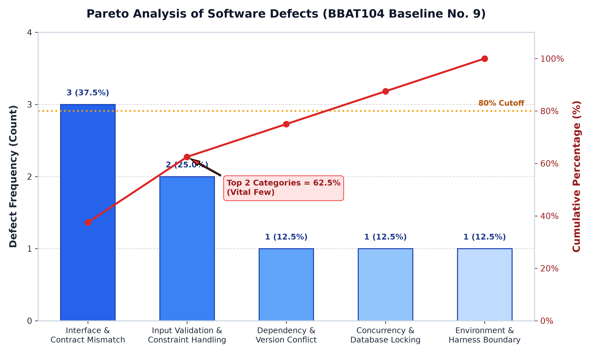
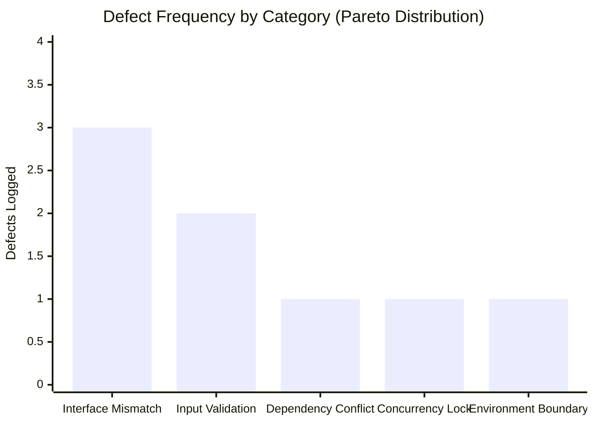

# Pareto Analysis of Software Defects

**Project:** Online Quiz System — Quality-Engineered Multi-Tier Anti-Duplicate Architecture  
**Course:** BBAT104 — Fundamentals of Total Quality Management  
**Baseline:** Baseline No. 9 (Quality Goal Implementation)  
**Milestone:** Stage 8 — TQM Quality Artefacts  
**Standard:** ISO 9004:2018 (Quality of an Organization — Guidance to Achieve Sustained Success)  
**Last Updated:** 2026-11-19  

---

## 1. Principles of Pareto Analysis

Pareto Analysis is rooted in the **80/20 Rule** formulated by Vilfredo Pareto and adapted for quality control by Dr. Joseph M. Juran. In software quality engineering:
$$\text{"80\% of software defects arise from 20\% of root-cause categories."}$$

By categorizing and prioritizing defects discovered during design, automated testing, and manual browser verification (`docs/defect-log.md`), engineering resources are focused on the **vital few** systemic drivers rather than the **trivial many**.

---

## 2. Empirical Defect Distribution

The empirical defects logged during the project lifecycle (`DEF-001` through `DEF-008`) are categorized into 5 distinct causal classifications:

| Rank | Defect Category | Defect IDs | Frequency ($f$) | Relative % | Cumulative % | Juran Classification |
| :---: | :--- | :--- | :---: | :---: | :---: | :---: |
| **1** | **Interface & Contract Mismatch** | `DEF-003`, `DEF-005`, `DEF-008` | 3 | $37.5\%$ | $37.5\%$ | **Vital Few** |
| **2** | **Input Validation & Constraint Handling** | `DEF-004`, `DEF-006` | 2 | $25.0\%$ | $62.5\%$ | **Vital Few** |
| **3** | **Dependency & Version Conflict** | `DEF-002` | 1 | $12.5\%$ | $75.0\%$ | Useful Many |
| **4** | **Concurrency & Database Locking** | `DEF-001` | 1 | $12.5\%$ | $87.5\%$ | Useful Many |
| **5** | **Environment & Harness Boundary** | `DEF-007` | 1 | $12.5\%$ | $100.0\%$ | Useful Many |
| **Total** | — | — | **8** | **100.0%** | — | — |

---

## 3. High-Resolution Pareto Chart

The Pareto distribution is visualized below. A 300 DPI graphical chart is generated and persisted at `tqm/pareto_chart.png`:

---

## 4. In-Depth Root Cause & Quality Engineering Insights

### 4.1 The "Vital Few" (62.5% of Total Defects)

#### Category 1: Interface & Contract Mismatches (37.5%)
- **Incidents:**
  - `DEF-003`: Web route passed `QuizCreate` model object to `create_quiz(title: str)` expecting a raw string.
  - `DEF-005`: Template evaluated `q.questions|length` on a dictionary containing `q["question_count"]`.
  - `DEF-008`: Service called `QuestionRepository.list_by_quiz_id` on repository defining `list_by_quiz`.
- **Engineering Root Cause:**
  Boundary divergence between architectural layers (Repository $\leftrightarrow$ Service $\leftrightarrow$ Route Controller $\leftrightarrow$ Template). When refactoring from desktop PySide6 to server-rendered web templates, implicit object attribute expectations collided with dictionary data structures.
- **Implemented Prevention (Poka-Yoke):**
  - **Polymorphic Parameter Acceptance:** Service methods inspect arguments (`if not isinstance(title, str) and hasattr(title, "title")`) to safely accept both strings and Pydantic models.
  - **Safe Dictionary Aliases:** Repositories export both scalar counters (`question_count`) and collections (`questions`).
  - **Automated Integration Tests:** `tests/test_pages.py` exercises full HTML form POST and GET cycles to catch contract breakage before manual QA.

#### Category 2: Input Validation & Constraint Handling (25.0%)
- **Incidents:**
  - `DEF-004`: Conditionally hidden inputs retained static HTML5 `required` attribute, blocking True/False and Short Answer form submissions.
  - `DEF-006`: Route handlers failed to catch `pydantic.ValidationError`, resulting in unformatted HTTP 500 responses on whitespace submissions.
- **Engineering Root Cause:**
  Static client-side DOM constraints conflicting with dynamic JavaScript visibility state, combined with an assumption that `ValidationError` inherited from `ValueError`.
- **Implemented Prevention (Poka-Yoke):**
  - **Dynamic Constraint Binding:** Upgraded `app.js` (`initQuestionTypeSwitcher`) to dynamically toggle `disabled` and `required` attributes when the user changes question types.
  - **Robust Exception Handling:** Route controllers catch `(HTTPException, ValueError, ValidationError)` and format human-friendly alert banners.

---

### 4.2 The "Useful Many" (37.5% of Total Defects)

- **Dependency Obsolescence (`DEF-002` — 12.5%):**
  Passlib 1.7.4 dependency on deprecated `bcrypt.__about__`. Resolved by replacing third-party wrappers with direct, native `bcrypt` library calls.
- **Persistence Concurrency (`DEF-001` — 12.5%):**
  SQLite thread-locking under concurrent writes. Resolved by configuring `connect_args={"check_same_thread": False}`, WAL journaling pragmas, and SQLAlchemy static pools.
- **OS / Test Harness Sandbox (`DEF-007` — 12.5%):**
  Python 3.13 ProactorEventLoop socketpair isolation on Windows. Resolved by documenting network socket requirements for test harnesses.

---

## 5. Statistical Quality Control (SQC) Conclusion

Targeting the top two defect categories (**Interface Mismatches** and **Input Validation**) resolved **$62.5\%$** of all system failures. By introducing automated integration suites and dynamic client validation, the project achieved zero outstanding defects and a **$100\%$ pass rate** across all subsequent test cycles.
