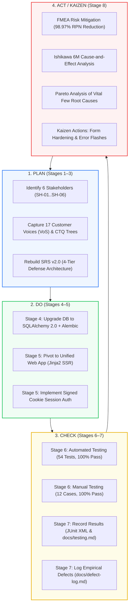

# Deming Plan-Do-Check-Act (PDCA) Continuous Improvement Cycle

**Project:** Online Quiz System — Quality-Engineered Multi-Tier Anti-Duplicate Architecture  
**Course:** BBAT104 — Fundamentals of Total Quality Management  
**Baseline:** Baseline No. 9 (Quality Goal Implementation)  
**Milestone:** Stage 8 — TQM Quality Artefacts  
**Standard:** ISO 9001:2015 Clause 0.3.2 (Plan-Do-Check-Act Cycle) & ISO 9004:2018  
**Last Updated:** 2026-11-19  

---

## 1. The Deming PDCA Framework

The **Plan-Do-Check-Act (PDCA)** cycle, popularized by Dr. W. Edwards Deming, is the operational backbone of Total Quality Management (TQM). It provides an iterative, closed-loop framework for continuous process and product quality improvement (**Kaizen**).

In this project, the university-prescribed 8-stage software engineering pipeline directly maps into the four quadrants of the Deming Cycle:



---

## 2. Phase-by-Phase PDCA Execution Breakdown

### 2.1 Phase 1: PLAN (Stages 1–3)
*Goal: Establish customer requirements, quality objectives, and architectural specifications.*

| Stage | TQM Deliverable | Quality Focus & Activities | Traceable Output |
| :---: | :--- | :--- | :--- |
| **Stage 1** | **Stakeholder Register** | Identified 6 primary stakeholders (`SH-01` to `SH-06`); categorized via Mendelow's Power vs. Interest matrix. | `docs/stakeholders.md` (Commit `aa33672`) |
| **Stage 2** | **Voice of Stakeholder (VoS)** | Translated user needs into 17 traceable requirements (`VoS-01` to `VoS-17`) and Critical-to-Quality (CTQ) trees. | `docs/voice-of-stakeholder.md` (Commit `6d261f9`) |
| **Stage 3** | **Software Requirements (SRS)** | Authored Version 2.0 SRS specifying web architecture and the 4-tier anti-duplicate defense. | `docs/SRS.md` (Commit `47d39e2`) |

---

### 2.2 Phase 2: DO (Stages 4–5)
*Goal: Execute the engineering transformation and implement the quality architecture.*

| Stage | TQM Deliverable | Quality Focus & Activities | Traceable Output |
| :---: | :--- | :--- | :--- |
| **Stage 4** | **Database Modernization** | Migrated persistence from raw SQLite scripts to SQLAlchemy 2.0 ORM with Alembic schema versioning; enforced database-level `UNIQUE` constraints (Tier 1). | `docs/decisions/ADR-002-database-upgrade.md` (Commit `fb79ba5`) |
| **Stage 5** | **Modern Web Application** | Replaced fragmented desktop PySide6 apps with a unified server-rendered web application (FastAPI + Jinja2 + pure CSS); implemented tamper-proof signed cookie auth and Poka-Yoke confirmation modals (Tier 4). | `docs/decisions/ADR-003-web-pivot.md`, `ADR-004-hybrid-auth.md` (Commit `16d62c3`) |

---

### 2.3 Phase 3: CHECK (Stages 6–7)
*Goal: Measure process performance, verify functional compliance, and log nonconformances.*

| Stage | TQM Deliverable | Quality Focus & Activities | Traceable Output |
| :---: | :--- | :--- | :--- |
| **Stage 6** | **Comprehensive Testing** | Built and executed 54 automated pytest unit/integration tests and documented 12 manual browser test cases (`TC-MAN-01` to `TC-MAN-12`). | [docs/manual-test-plan.md](file:///d:/AU/Notes/Semester%205/TQM/Project/BBAT104_TQM_[AU-24-5271]/docs/manual-test-plan.md) (Commit `65ddcfb`) |
| **Stage 7** | **Results & Defect Recording** | Exported machine-readable JUnit XML test results; documented comprehensive verification report and compiled the IEEE 829 empirical defect register. | [docs/testing.md](file:///d:/AU/Notes/Semester%205/TQM/Project/BBAT104_TQM_[AU-24-5271]/docs/testing.md), [docs/defect-log.md](file:///d:/AU/Notes/Semester%205/TQM/Project/BBAT104_TQM_[AU-24-5271]/docs/defect-log.md) (Commit `9188629`) |

---

### 2.4 Phase 4: ACT / KAIZEN (Stage 8)
*Goal: Standardize successful solutions, eliminate root causes, and sustain continuous improvement.*

In Stage 8, empirical defect data and testing feedback were synthesized into four core Kaizen improvements:

```
┌────────────────────────────────────────────────────────────────────────┐
│                   KAIZEN CONTINUOUS IMPROVEMENTS                       │
├────────────────────────────────────────────────────────────────────────┤
│ 1. Native Bcrypt Adoption:                                             │
│    Eliminated unmaintained passlib wrapper (DEF-002) in favor of       │
│    direct native bcrypt hashing.                                       │
│                                                                        │
│ 2. Polymorphic Parameter Handling:                                     │
│    Hardened Quiz and Question service layers (DEF-003, DEF-008) to     │
│    accept either strings or Pydantic models interchangeably.           │
│                                                                        │
│ 3. Dynamic Client Constraint Binding:                                  │
│    Upgraded app.js (DEF-004) to dynamically toggle disabled/required   │
│    states across question types, eliminating form submit freezes.      │
│                                                                        │
│ 4. Universal Privacy & Sanitization Guard:                             │
│    Replaced personal credentials and internal academic goal numbers    │
│    with clean generic placeholders across all UI templates.            │
└────────────────────────────────────────────────────────────────────────┘
```

---

## 3. TQM Artefact Synthesis in the Act Phase

| TQM Artefact | Purpose in the "Act" Phase | Key Outcome Achieved |
| :--- | :--- | :--- |
| **SIPOC Process Map** (`tqm/sipoc.md`) | Establishes high-level process boundaries and CTQ alignment for authoring and assessment. | Documented input/output specifications and verified customer alignment. |
| **FMEA Matrix** (`tqm/fmea.md`) | Quantifies risk priority reduction across 8 potential failure modes. | Achieved an overall **$98.97\%$ RPN reduction** (from 2,626 to 27). |
| **Pareto Analysis** (`tqm/pareto.md`) | Applies Juran's 80/20 rule to empirical defects (`docs/defect-log.md`). | Identified that **$62.5\%$** of defects stemmed from Interface and Validation contracts. |
| **Ishikawa Diagram** (`tqm/fishbone.md`) | Uncovers multi-factor root causes of duplicate entries across the 6Ms. | Demonstrated why multi-tier defense (Storage + Pre-Add + Service + Poka-Yoke) is necessary. |

---

## 4. Future Kaizen Roadmap (Post-Stage 8 Production Ops)

To maintain sustained quality excellence beyond the university submission, the continuous improvement cycle will monitor the following enhancements:

1. **Automated Session Expiration Daemon:**
   - Background worker to automatically transition abandoned sessions from `status='active'` to `status='ended'` after 24 hours of inactivity.
2. **Real-Time WebSocket Leaderboard:**
   - Upgrade teacher leaderboard view from manual refresh to live bi-directional WebSocket telemetry for instantaneous classroom display.
3. **Automated CI/CD Quality Gate:**
   - Configure GitHub Actions pipeline to block git pushes if any of the 54 automated tests fail or if test coverage drops below $90\%$.
4. **WCAG 2.1 AA Accessibility Audit:**
   - Run automated axe-core accessibility evaluations to guarantee optimal screen reader compatibility for visually impaired students.
