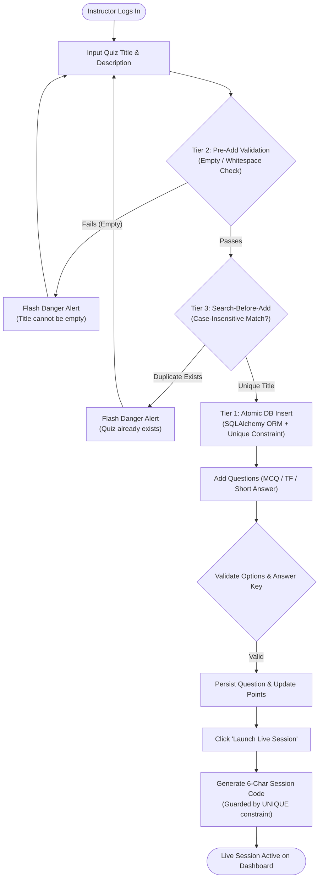
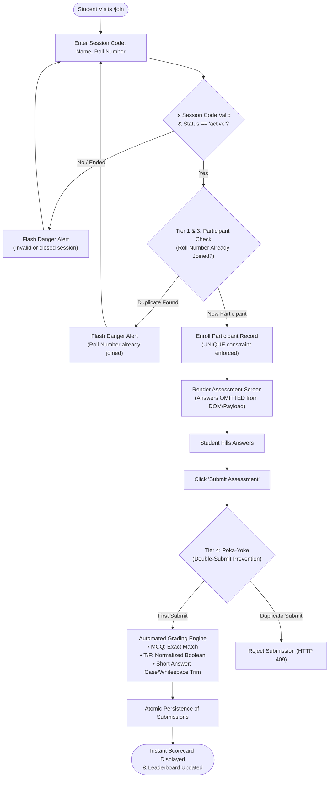

# SIPOC Process Map — Online Quiz Assessment System

**Project:** Online Quiz System — Quality-Engineered Multi-Tier Anti-Duplicate Architecture  
**Course:** BBAT104 — Fundamentals of Total Quality Management  
**Baseline:** Baseline No. 9 (Quality Goal Implementation)  
**Milestone:** Stage 8 — TQM Quality Artefacts  
**Standard:** ISO 9001:2015 Clause 4.4 (Quality Management System & Its Processes)  
**Last Updated:** 2026-11-19  

---

## 1. Process Overview & Objectives

In Total Quality Management (TQM), **SIPOC** (**S**uppliers, **I**nputs, **P**rocess, **O**utputs, **C**ustomers) serves as a high-level visual tool to define the scope and boundaries of operational processes before detailed optimization.

For the **Online Quiz Assessment System**, two distinct, coupled operational lifecycles govern the platform:
1. **Lifecycle 1: Quiz Authoring & Assessment Administration** *(Instructor Perspective)*
2. **Lifecycle 2: Live Assessment Participation & Automated Evaluation** *(Student Perspective)*

Both lifecycles integrate the **4-Tier Anti-Duplicate Defense Architecture** to eliminate data redundancy, duplicate records, and conflicting submissions.

---

## 2. High-Level SIPOC Flowchart

```mermaid
flowchart LR
    subgraph S["1. SUPPLIERS"]
        S1["Instructors / TAs"]
        S2["Academic Dept"]
        S3["Students"]
    end

    subgraph I["2. INPUTS"]
        I1["Course Syllabus"]
        I2["Question Banks"]
        I3["Student Roll Numbers"]
        I4["Exam Responses"]
    end

    subgraph P["3. PROCESS (Core System)"]
        P1["Auth & Session Admin"]
        P2["Sanitization & Validation"]
        P3["Search-Before-Add Guard"]
        P4["Assessment & Scoring"]
    end

    subgraph O["4. OUTPUTS"]
        O1["Verified Quizzes"]
        O2["Unique 6-Char Sessions"]
        O3["Graded Scorecards"]
        O4["Analytics & Leaderboards"]
    end

    subgraph C["5. CUSTOMERS"]
        C1["Enrolled Students"]
        C2["Course Instructors"]
        C3["University Exam Board"]
    end

    S --> I
    I --> P
    P --> O
    O --> C

    classDef stage fill:#f8fafc,stroke:#3b82f6,stroke-width:2px;
    class S,I,P,O,C stage;
```

---

## 3. Lifecycle 1: Quiz Authoring & Administration

### 3.1 Process Boundaries
- **Start Trigger:** Instructor authenticates via `/auth/login` and accesses the authoring interface.
- **Stop Trigger:** Instructor launches an active session, generating a live 6-character code (`/quizzes/{id}/sessions`).

### 3.2 SIPOC Matrix Table

| Element | Component | Detailed Specifications & Criteria |
| :--- | :--- | :--- |
| **Suppliers (S)** | • Course Instructor (`SH-01`) • Academic Curriculum Committee (`SH-03`) • System Administrator (`SH-06`) | Qualified faculty authoring assessment materials conforming to course learning objectives and syllabus criteria. |
| **Inputs (I)** | • Teacher Credentials (`email`, `password`) • Quiz Metadata (`title`, `description`) • Question Items (MCQ, True/False, Short Answer) • Point Weights & Correct Answer Keys | Valid UTF-8 strings, normalized whitespace, distinct multiple-choice option arrays ($2 \le n \le 6$). |
| **Process (P)** | **Step 1:** Instructor Authentication (`POST /auth/login`) **Step 2:** Pre-Add Validation & Whitespace Stripping (Tier 2) **Step 3:** Search-Before-Add Duplicate Check (Tier 3) **Step 4:** Atomic Database Persistence (Tier 1 ORM) **Step 5:** Session Generation (`POST /quizzes/{id}/sessions`) | Sequential pipeline guarded by database transactions and Pydantic validation schemas. |
| **Outputs (O)** | • Authenticated Session Cookie (`session_user_id`) • Clean Quiz Entity (`id`, `title`, `question_count`) • Live Session Record (`session_code`, `status='active'`) • Deletion Confirmation Modals (Poka-Yoke Tier 4) | Tamper-proof signed session token, collision-free 6-character uppercase session code. |
| **Customers (C)**| • Enrolled Course Students (`SH-02`) • Course Instructors (`SH-01`) • Academic Dept / Evaluators (`SH-03 / SH-04`) | End users consuming the created assessment for formal evaluation. |

### 3.3 Detailed Process Flow Diagram

---

## 4. Lifecycle 2: Live Assessment Participation & Auto-Grading

### 4.1 Process Boundaries
- **Start Trigger:** Student navigates to `/join` and enters a 6-character session code.
- **Stop Trigger:** Student submits answers and receives an immediate graded scorecard (`/session/{code}/results`).

### 4.2 SIPOC Matrix Table

| Element | Component | Detailed Specifications & Criteria |
| :--- | :--- | :--- |
| **Suppliers (S)** | • Enrolled Students (`SH-02`) • Active Session Engine (`SH-01`) • University Enrollment Database (`SH-04`) | Authenticated or registered course candidates presenting official Student ID credentials. |
| **Inputs (I)** | • 6-Character Session Code (e.g., `TQM101`) • Student Full Name (`student_name`) • University Roll Number (`student_identifier`) • Answer Submissions (`q_{id}` form fields) | Case-insensitive normalized code, uppercase-normalized roll number string, form payloads. |
| **Process (P)** | **Step 1:** Session Availability Check (`status == 'active'`) **Step 2:** Participant Anti-Duplicate Join Guard (Tier 1 & 3) **Step 3:** Answer-Omitted Assessment Delivery (`GET /take`) **Step 4:** Double-Submit Interception (Poka-Yoke Tier 4) **Step 5:** Automated Multi-Type Evaluation (Grading Engine) **Step 6:** Scorecard Compilation & Analytics Aggregation | Fast transaction pipeline ($< 100\text{ ms}$ evaluation response time). |
| **Outputs (O)** | • Participant Record (`id`, `session_id`, `joined_at`) • Immutable Submissions Table (`points_awarded`) • Instant Student Scorecard (`total_score`, `% score`) • Teacher Analytics Summary (Accuracy rate per question) | Detailed breakdown showing points awarded per question, correct answers, and leaderboard rank. |
| **Customers (C)**| • Individual Participating Student (`SH-02`) • Course Instructor (`SH-01`) • Academic Dept / Evaluators (`SH-03 / SH-04`) | Consumers of accurate, tamper-proof academic assessment metrics. |

### 4.3 Detailed Assessment Flow Diagram

---

## 5. Critical-to-Quality (CTQ) Process Measures

Linking the SIPOC process steps directly to the customer voices identified in `docs/voice-of-stakeholder.md`:

| Process Step | Quality Characteristic | Target CTQ Metric | Verification Mechanism |
| :--- | :--- | :---: | :--- |
| **Session Code Generation** | Randomness & Non-Collision | $0\%$ Duplicate Codes | Relational `UNIQUE` constraint on `Session.session_code`. |
| **Student Enrollment** | Participant Uniqueness | $0\%$ Duplicate Joins | Composite `UNIQUE(session_id, student_identifier)`. |
| **Assessment Delivery** | Academic Integrity | $0\%$ Answer Exposure | Inspection of `GET /api/sessions/{code}/questions` payload. |
| **Assessment Submission** | Non-Repudiation | Exactly 1 submission/student | Constraint on `Submission(participant_id, question_id)`. |
| **Automated Grading** | Evaluation Accuracy | $100\%$ Grading Precision | Case-insensitive and whitespace-tolerant evaluator. |
| **System Response** | Latency Performance | $< 200\text{ ms}$ Response Time | Verified via automated test execution (15.76s for 54 tests). |
